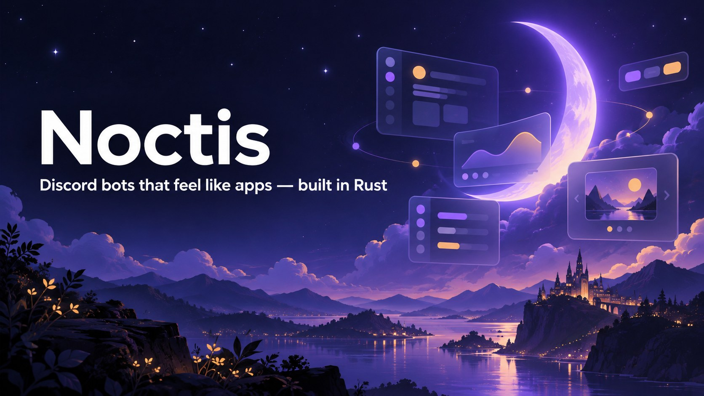
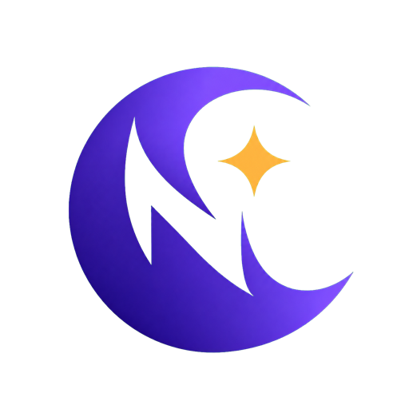
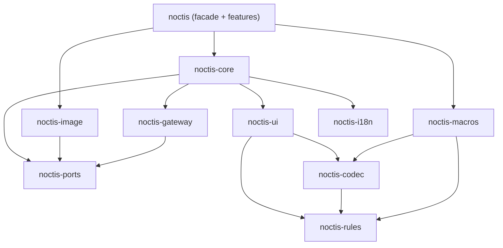

<p align="center">
  
</p>

<p align="center">
  
</p>

<h3 align="center">Noctis</h3>

<p align="center">
  A Rust framework for Discord bots that look and feel like applications.<br>
  Built on <a href="https://github.com/twilight-rs/twilight">twilight</a>. Sharded across every core. Components V2 dashboards and generated images out of the box.
</p>

<p align="center">
  
  
  
  
  
  
</p>

---

> [!IMPORTANT]
> **Noctis is under active development and not yet published.** Epics 1–4 are done
> (workspace, Discord rules as code, length-proven `custom_id`s, storage ports, the
> Components V2 and modal model with compile-time checks), and Epic 5 (a running sharded
> bot) is in progress. Nothing is on crates.io yet, and the public API can still change.
> The code below is an API preview. See the [roadmap](#roadmap) for live progress.

## Why Noctis?

Discord's **Components V2** lets a message act like a small dashboard: containers,
sections, galleries, selects and buttons. Few bots use it well. The limits are strict
(40 components, 4000 characters, 100-character `custom_id`s), and keeping state
across clicks is tedious. In Rust, you also have to build the shard supervisor,
command tree, publish script, `custom_id` parser and image pipeline yourself.

Noctis provides all of that as one layer with sensible defaults:

- **Slash commands as entry points.** `/setup start` takes no options and opens a
  full interactive screen. You write each screen as a plain render function; tabs,
  pages and steps are typed fields of your own Routes, and one call
  (`ctx.update(render(..))`) redraws the message with the right flags and deferral.
- **Discord's rules checked at compile time.** If a `custom_id` could exceed 100
  characters, if a command pattern is illegal, or if a static component tree breaks
  nesting rules, `cargo build` fails, not production.
- **One handler per component id, never per message.** State travels in typed
  Payloads or short Refs, so handlers survive restarts and work across shards and
  processes.
- **Pluggable storage everywhere.** Each storage-like concern is a trait with an
  in-memory default. Implement it on your own struct (Redis, Postgres, anything) and
  pass that in.
- **Generated images as a built-in feature.** Write Tailwind-styled templates in
  Rust and get PNG, WebP or animated WebP/GIF, rendered natively by
  [takumi](https://github.com/kane50613/takumi) with no browser, Node.js or Tailwind
  CLI.
- **Built for scale.** Noctis is designed for bots serving millions of users, with
  bounded memory and no per-message allocations.

## Features

| | |
| --- | --- |
| **Gateway and sharding** | Recommended shard count and identify concurrency, one tokio task per shard, Shard Ranges for multi-process Clusters, session resume across restarts, graceful shutdown |
| **Commands** | `"settings logs channel"` becomes command, group and subcommand. Patterns like `"config (set\|get) (prefix\|welcome)"` are supported, with typed option structs, autocomplete, context menus, localized names, and Publish only when something changed |
| **Interaction routing** | O(1) dispatch by Route, typed Payloads with a compile-time length proof, Refs (11-char, ≥64-bit random keys) for large state, expiry handling, middleware with typed extensions, automatic defer before the 3 s deadline |
| **Components V2 UI kit** | Typed builders for every V2 and modal component with placement checked by the type system, compile-time and runtime limit validation, cost and "how many rows fit" budget helpers, Route-built components with length-proven `custom_id`s, an ergonomic Responder (`ctx.respond`, `ctx.update`, `ctx.reply_text`), attachment tracking. No widget layer: tabs, pagination and step flows are short recipes you own |
| **Images and GIFs** | `view!` / `tw!` templates with Tailwind v4 classes validated at compile time, a bounded render pool, render cache with request de-duplication, font and asset registry |
| **Adapters** | RefStore, SessionStore, RateLimitStore, RenderCache, AssetStore, LocaleSource, CacheStore, ModuleStateStore, IdentifyQueue. In-memory defaults ship, and a conformance test suite checks your own implementations |
| **Localization** | Locale files compiled into typed accessors, word-by-word command name translation, User and Guild Locale on every context |
| **Modules** | Composable feature modules, enabled or disabled at runtime (globally or per guild), plus rate limits and lifecycle hooks |
| **Developer experience** | One crate (`noctis`) with features, a testing kit that simulates interactions without Discord, and a project template whose AI-agent skill documents the whole API |

## A taste of the API

> API preview: names follow the [architecture spine](_bmad-output/planning-artifacts/architecture/architecture-noctis-rs-2026-10-19/ARCHITECTURE-SPINE.md) and may change before 0.1.

```rust
use noctis::prelude::*;

#[derive(PayloadEnum, Clone, Copy, PartialEq, Eq)]
enum Tab { Overview, Members }

/// One struct per interaction: the derive names the kind, the fields are the
/// typed state carried inside the custom_id (its maximum length is proven at
/// compile time), and the handler is a method.
#[derive(Button, Clone, Copy)]
#[button("dash.tab", defaults(style = Secondary, label = "Tab"))]
struct OpenTab { guild: Id<GuildMarker>, tab: Tab }

#[derive(Button, Clone, Copy)]
#[button("dash.page", defaults(style = Secondary, emoji = "▶️"))]
struct MembersPage { guild: Id<GuildMarker>, page: u16 }

/// The View: a plain function. The command and every click call it.
fn render_dashboard(members: &[Member], guild: Id<GuildMarker>, tab: Tab, page: u16) -> V2Message {
    let tabs = ActionRow::buttons([Tab::Overview, Tab::Members].map(|t| {
        OpenTab { guild, tab: t }.build().label(t.label()).disabled(t == tab)
    }));
    let c = Container::new().push(tabs);
    let c = match tab {
        Tab::Overview => c.push(TextDisplay::new(format!("**{}** members", members.len()))),
        Tab::Members => c.push(TextDisplay::new(page_text(members, page))).push(ActionRow::buttons([
            MembersPage { guild, page: page.saturating_sub(1) }.build().label("◀").disabled(page == 0),
            MembersPage { guild, page: page + 1 }.build().label("▶").disabled(is_last(members, page)),
        ])),
    };
    V2Message::new(Components::new().push(c))   // limits are validated before sending
}

/// `/dashboard`: no options, opens the dashboard.
#[derive(SlashCommand)]
#[command("dashboard", description = "Open the server dashboard")]
struct Dashboard;

impl Dashboard {
    #[handler]
    async fn handle(self, ctx: CommandCtx) -> HandlerResult<V2Message> {
        let Some(guild) = ctx.guild_id() else {
            return Ok(V2Message::new(Components::new().push(TextDisplay::new("Servers only."))));
        };
        let members = ctx.state::<Db>().members(guild).await?;
        Ok(render_dashboard(&members, guild, Tab::Overview, 0))
    }
}

/// One handler for every tab button, on every message, on every shard.
impl OpenTab {
    #[handler]
    async fn handle(self, ctx: ComponentCtx) -> HandlerResult<Responded> {
        let members = ctx.state::<Db>().members(self.guild).await?;
        ctx.update(render_dashboard(&members, self.guild, self.tab, 0)).await   // flags, defer, limits handled
    }
}

impl MembersPage {
    #[handler]
    async fn handle(self, ctx: ComponentCtx) -> HandlerResult<Responded> {
        let members = ctx.state::<Db>().members(self.guild).await?;
        ctx.update(render_dashboard(&members, self.guild, Tab::Members, self.page)).await
    }
}

fn dashboard_module() -> Module {
    Module::new("dashboard").add::<Dashboard>().add::<OpenTab>().add::<MembersPage>()
}

#[tokio::main]
async fn main() -> noctis::Result<()> {
    App::builder()
        .token_from_env()
        .module(dashboard_module())
        .ref_store(MyRedisRefStore::connect("redis://…").await?) // optional: memory by default
        .build()?          // runs every rule that needs the whole app, before connecting
        .run()
        .await
}
```

This doesn't compile, on purpose:

```rust
#[derive(SlashCommand)]
#[command("config (set|get) (prefix|welcome)?", description = "Settings")]
//        ^ error[CMD-11]: "config set" would be both a subcommand and a subcommand group
```

## Architecture at a glance



- **Hexagonal core.** Pure crates hold the rules, codec and UI model. Storage goes
  only through ports, and Discord I/O lives at the edge.
- **One source of truth for Discord rules.** `noctis-rules` is used by the proc
  macros at compile time and by the validators at runtime. Every rule has an id in
  [`docs/discord-rules.md`](docs/discord-rules.md).
- **Lane-based runtime.** Shard tasks only read and enqueue. Interactions have a
  priority lane and are never dropped. Heartbeats never wait on handlers.

Read the full design:

| Document | What it covers |
| --- | --- |
| [Product brief](_bmad-output/planning-artifacts/briefs/brief-noctis-rs-2026-10-19/brief.md) | Vision, problem, audience |
| [PRD](_bmad-output/planning-artifacts/prds/prd-noctis-rs-2026-10-19/prd.md) | 79 functional and 10 non-functional requirements, UI Doctrine, priorities |
| [Architecture spine](_bmad-output/planning-artifacts/architecture/architecture-noctis-rs-2026-10-19/ARCHITECTURE-SPINE.md) | 29 architecture decisions, crate layers, conventions, stack |
| [Discord rules catalog](docs/discord-rules.md) | Every Discord limit Noctis enforces and where (compile time, App build or runtime) |
| [Research](_bmad-output/planning-artifacts/research/) | twilight, Components V2, takumi, and the tescord/dbi features Noctis carries over |

## Roadmap

Noctis is planned and built with the [BMad Method](https://docs.bmad-method.org/). The
work is split into 15 epics and 96 stories
([`epics.md`](_bmad-output/planning-artifacts/epics.md)). Each story is planned, implemented,
checked by the local gates and reviewed in four independent layers before it is marked
done. Live per-story status is in
[`sprint-status.yaml`](_bmad-output/implementation-artifacts/sprint-status.yaml).

### ✅ Design (done)
- [x] Research: twilight 0.17, Discord Components V2, takumi, tescord/dbi feature parity
- [x] Product brief, PRD (FR-1…FR-79, NFR-1…NFR-10), UI Doctrine
- [x] Architecture spine and Discord rules catalog
- [x] Epics and stories, readiness gate, project template and AI-agent usage skill

### Implementation

| | Epic | Priority | Status |
| --- | --- | --- | --- |
| 1 | Project foundation and Discord rules as code | P0 | ✅ Done |
| 2 | Typed, length-proven `custom_id`s | P0 | ✅ Done |
| 3 | Pluggable storage ports | P0 | ✅ Done |
| 4 | Components V2 and modal model with limit validation | P0 | ✅ Done |
| 5 | A running sharded bot | P0 | 🔨 In progress (4 / 8) |
| 6 | Slash commands and Publish | P0 | ⏳ Next |
| 7 | Routed components, Refs and modals | P0 | ⏳ |
| 8 | Views as plain functions, Responder ergonomics and the testing kit | P0 | ⏳ |
| 9 | Attachments, webhooks and advanced component surfaces | P1 | ⏳ |
| 10 | Generated images and GIFs | P1 | ⏳ |
| 11 | Localization | P1 | ⏳ |
| 12 | Clusters and scale | P1 | ⏳ |
| 13 | Module operations | P1 | ⏳ |
| 14 | v1 launch readiness → **v0.1.0 on crates.io** | P1 | ⏳ |
| 15 | Opt-in extras (prefix commands, Renderer seam, multiple Apps, presence) | P2 | ⏳ |

**What already works**

- **Workspace and quality gates.** There are 12 crates in strict layers, enforced by
  `xtask deps-check`. Builds use release-equivalent profiles only. Local gates cover
  fmt, clippy `-D warnings`, tests, `cargo-hack` per-feature tests, `cargo-deny`, an
  MSRV 1.91 check, a public-API snapshot and a Usage Skill coverage check.
- **`noctis-rules`.** Every rule in [`docs/discord-rules.md`](docs/discord-rules.md) is
  code with a stable id, shared by the macros and the runtime, and `xtask rules-catalog`
  cross-checks the two.
- **`noctis-codec`.**
  - An ASCII `custom_id` format with escaped fields, Refs and integrity tags.
  - `derive(Route, Payload, PayloadEnum)`, which proves the ≤ 100-character limit at
    compile time.
  - Zero-allocation inline decoding.
- **`noctis-ports`.**
  - Port traits with atomic ops.
  - Bounded in-memory defaults with TTL.
  - An in-memory `IdentifyQueue` with identify buckets.
- **`noctis-ui`.**
  - Typed Components V2 and modal models, with placement rules in the type system.
  - A runtime Limit validator with path-precise errors.
  - Compile-time literal and arity checks, and the `components!` tree macro.
  - `derive(Modal)` with typed submissions.
- **`noctis-core` / `noctis-gateway`.**
  - The App builder, Runtime and Plugin seam, with startup safety (typed errors
    instead of panics).
  - HTTP proxy mode.
  - Sharding on `twilight-gateway` with bucketed identify.
- **`noctis-testkit`.** Local fakes of the Discord HTTP API and the gateway, so every
  test runs without Discord.

### 🔭 Beyond v1
- Official Redis and SQL adapter crates
- Zero-downtime resharding and a cross-process request bus
- A library of reusable Views and image templates (cards, leaderboards, charts)
- Locale scaffolding CLI, a named-emoji registry, runtime-loaded templates

## Project template

[`examples/project-template/`](examples/project-template/) is a ready-to-copy bot. It
includes a hand-written setup flow, a tabbed dashboard with pagination, and a rendered
profile card. It ships with:

- an `AGENTS.md` for AI coding agents;
- **the Noctis Usage Skill**, a detailed skill that documents the whole public API,
  every Components V2 component and limit, and the UI rulebook, so agents can build
  bots without reading Noctis source;
- the `rust-best-practices` skill.

The template is updated in the same commit as every public API change, and the
`skill-check` and `api-snapshot` gates enforce this.

## Lineage

Noctis brings the ergonomics of [tescord](https://www.npmjs.com/package/tescord) and
[`@mostfeatured/dbi`](https://www.npmjs.com/package/@mostfeatured/dbi) to Rust:
space-separated command names, auto-publish, typed locales, and data in
`custom_id`s. It fixes their known gaps: O(n) dispatch, unchecked `custom_id`
length, refs lost on restart, and silently dropped options.

## Building from source

Noctis needs Rust 1.97 for development (pinned in `rust-toolchain.toml`); its MSRV is 1.91.
The repository builds with release-equivalent profiles only, so always pass `--release`:

```sh
cargo build --release --workspace
cargo test --release --workspace
cargo clippy --release --workspace --all-targets --all-features -- -D warnings
```

The full list of local gates (deps-check, rules-catalog, api-snapshot, skill-check,
cargo-deny, MSRV) is in [`AGENTS.md`](AGENTS.md). CI is paused during development; the
workflows will be re-enabled before the v0.1.0 release.

## Contributing

Noctis is being built story by story right now. Issues about the PRD, the architecture
or the API preview are welcome; outside code contributions will open after v0.1.0.
Repository conventions for humans and AI agents are in [`AGENTS.md`](AGENTS.md).

## License

Licensed under either of

- Apache License, Version 2.0 ([LICENSE-APACHE](LICENSE-APACHE) or <https://www.apache.org/licenses/LICENSE-2.0>)
- MIT license ([LICENSE-MIT](LICENSE-MIT) or <https://opensource.org/licenses/MIT>)

at your option.

Unless you explicitly state otherwise, any contribution intentionally submitted for
inclusion in the work by you, as defined in the Apache-2.0 license, shall be dual
licensed as above, without any additional terms or conditions.

<p align="center"><sub>Noctis: Latin for "of the night".</sub></p>
