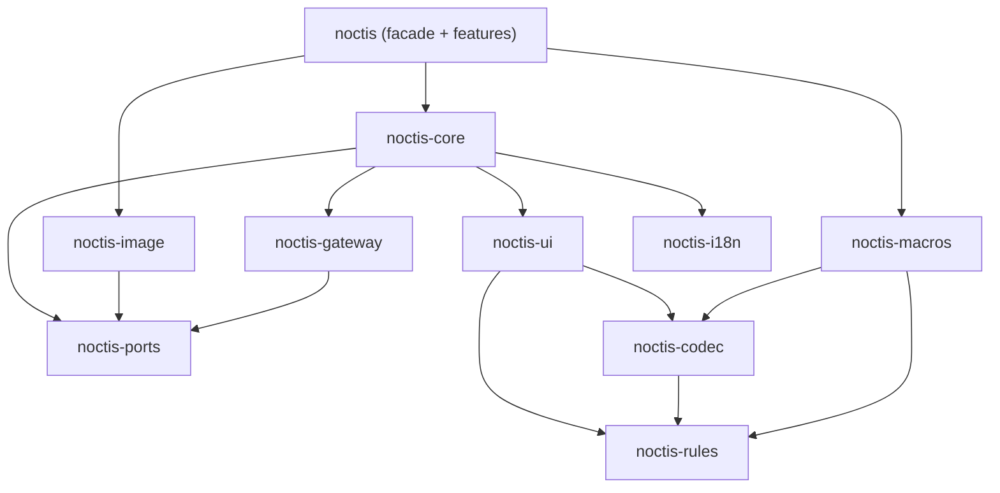

<p align="center">
  
</p>

<p align="center">
  
</p>

<h3 align="center">Noctis</h3>

<p align="center">
  A Rust framework for Discord bots that look and feel like applications.<br>
  Built on <a href="https://github.com/twilight-rs/twilight">twilight</a>. Sharded across every core. Components V2 dashboards and generated images out of the box.
</p>

<p align="center">
  
  
  
  
  
</p>

---

> [!IMPORTANT]
> **Noctis is in its design phase.** The product requirements, architecture and
> Discord rules catalog are written; the crates are not. The code below is an API
> preview taken from the architecture and will change. Watch the repository or
> check the [roadmap](#roadmap) to follow progress.

## Why Noctis?

Discord's **Components V2** lets a message act like a small dashboard: containers,
sections, galleries, selects and buttons. Few bots use it well. The limits are strict
(40 components, 4000 characters, 100-character `custom_id`s), and keeping state
across clicks is tedious. In Rust, you also have to build the shard supervisor,
command tree, publish script, `custom_id` parser and image pipeline yourself.

Noctis provides all of that as one layer with sensible defaults:

- **Slash commands as entry points.** `/setup start` takes no options and opens a
  full interactive View with steps, tabs and pages.
- **Discord's rules checked at compile time.** If a `custom_id` could exceed 100
  characters, if a command pattern is illegal, or if a static component tree breaks
  nesting rules, `cargo build` fails, not production.
- **One handler per component id, never per message.** State travels in typed
  Payloads or short Refs, so handlers survive restarts and work across shards and
  processes.
- **Pluggable storage everywhere.** Each storage-like concern is a trait with an
  in-memory default. Implement it on your own struct (Redis, Postgres, anything) and
  pass that in.
- **Generated images as a built-in feature.** Write Tailwind-styled templates in
  Rust and get PNG, WebP or animated WebP/GIF, rendered natively by
  [takumi](https://github.com/kane50613/takumi) with no browser, Node.js or Tailwind
  CLI.
- **Built for scale.** Noctis is designed for bots serving millions of users, with
  bounded memory and no per-message allocations.

## Features

| | |
| --- | --- |
| **Gateway and sharding** | Recommended shard count and identify concurrency, one tokio task per shard, Shard Ranges for multi-process Clusters, session resume across restarts, graceful shutdown |
| **Commands** | `"settings logs channel"` becomes command, group and subcommand. Patterns like `"config (set\|get) (prefix\|welcome)"` are supported, with typed option structs, autocomplete, context menus, localized names, and Publish only when something changed |
| **Interaction routing** | O(1) dispatch by Route, typed Payloads with a compile-time length proof, Refs (11-char, ≥64-bit random keys) for large state, expiry handling, middleware with typed extensions, automatic defer before the 3 s deadline |
| **Components V2 UI kit** | Typed builders for every V2 and modal component, a full limit validator, Views, Navbar tabs, step Wizards, an auto-packing Paginator, attachment tracking |
| **Images and GIFs** | `view!` / `tw!` templates with Tailwind v4 classes validated at compile time, a bounded render pool, render cache with request de-duplication, font and asset registry |
| **Adapters** | RefStore, SessionStore, RateLimitStore, RenderCache, AssetStore, LocaleSource, CacheStore, ModuleStateStore, IdentifyQueue. In-memory defaults ship, and a conformance test suite checks your own implementations |
| **Localization** | Locale files compiled into typed accessors, word-by-word command name translation, User and Guild Locale on every context |
| **Modules** | Composable feature modules, enabled or disabled at runtime (globally or per guild), plus rate limits and lifecycle hooks |
| **Developer experience** | One crate (`noctis`) with features, a testing kit that simulates interactions without Discord, and a project template whose AI-agent skill documents the whole API |

## A taste of the API

> API preview: names follow the [architecture spine](_bmad-output/planning-artifacts/architecture/architecture-noctis-rs-2026-10-19/ARCHITECTURE-SPINE.md) and may change before 0.1.

```rust
use noctis::prelude::*;

/// Typed state carried inside the button's custom_id.
/// Its maximum encoded length is checked at compile time.
#[derive(Payload)]
struct MembersPage {
    guild: Id<GuildMarker>,
    page: u16,
}

#[derive(Route)]
#[route("members-page")]
struct MembersPageRoute(MembersPage);

/// `/dashboard`: no options, opens a tabbed View.
#[command("dashboard", description = "Open the server dashboard")]
async fn dashboard(ctx: CommandCtx) -> HandlerResult {
    let guild = ctx.guild_id()?;
    ctx.respond(render_dashboard(&ctx, guild, Tab::Overview).await?).await
}

/// One handler for every "members page" button, on every message, on every shard.
#[component(MembersPageRoute)]
async fn members_page(ctx: ComponentCtx, MembersPage { guild, page }: MembersPage) -> HandlerResult {
    let members = ctx.state::<Db>().members(guild).await?;
    ctx.update(
        View::v2()
            .navbar(Tab::Members)
            .paginate(members, page, |m, s| s.text(format!("**{}**: {}", m.name, m.role))),
    )
    .await
}

#[tokio::main]
async fn main() -> noctis::Result<()> {
    App::builder()
        .token_from_env()
        .module(dashboard_module())
        .ref_store(MyRedisRefStore::connect("redis://…").await?) // optional: memory by default
        .build()?          // runs every rule that needs the whole app, before connecting
        .run()
        .await
}
```

This doesn't compile, on purpose:

```rust
#[command("config (set|get) (prefix|welcome)?")]
//        ^ error[CMD-11]: "config set" would be both a subcommand and a subcommand group
```

## Architecture at a glance



- **Hexagonal core.** Pure crates hold the rules, codec and UI model. Storage goes
  only through ports, and Discord I/O lives at the edge.
- **One source of truth for Discord rules.** `noctis-rules` is used by the proc
  macros at compile time and by the validators at runtime. Every rule has an id in
  [`docs/discord-rules.md`](docs/discord-rules.md).
- **Lane-based runtime.** Shard tasks only read and enqueue. Interactions have a
  priority lane and are never dropped. Heartbeats never wait on handlers.

Read the full design:

| Document | What it covers |
| --- | --- |
| [Product brief](_bmad-output/planning-artifacts/briefs/brief-noctis-rs-2026-10-19/brief.md) | Vision, problem, audience |
| [PRD](_bmad-output/planning-artifacts/prds/prd-noctis-rs-2026-10-19/prd.md) | 79 functional and 10 non-functional requirements, UI Doctrine, priorities |
| [Architecture spine](_bmad-output/planning-artifacts/architecture/architecture-noctis-rs-2026-10-19/ARCHITECTURE-SPINE.md) | 29 architecture decisions, crate layers, conventions, stack |
| [Discord rules catalog](docs/discord-rules.md) | Every Discord limit Noctis enforces and where (compile time, App build or runtime) |
| [Research](_bmad-output/planning-artifacts/research/) | twilight, Components V2, takumi, and the tescord/dbi features Noctis carries over |

## Roadmap

Noctis is planned with the [BMad Method](https://docs.bmad-method.org/). Each
milestone maps to requirement ids in the PRD.

### ✅ Phase 0: Design (done)
- [x] Research: twilight 0.17, Discord Components V2, takumi, tescord/dbi feature parity
- [x] Product brief, PRD (FR-1…FR-79, NFR-1…NFR-10), UI Doctrine
- [x] Architecture spine (29 decisions) and Discord rules catalog
- [x] Project template and AI-agent usage skill scaffold

### 🔨 Milestone 1: Foundations (P0)
- [ ] Workspace, CI (fmt, clippy, tests, `trybuild`, MSRV, cargo-deny, public-API snapshot)
- [ ] `noctis-rules`: the rule catalog as code, shared by macros and runtime
- [ ] `noctis-codec`: the `custom_id` format, `Payload` / `Route` derives, compile-time length proof
- [ ] `noctis-ports`: port traits and bounded in-memory adapters
- [ ] `noctis-gateway`: sharding, lanes, identify concurrency, startup safety
- [ ] `noctis-core`: App, Modules, Registry, dispatch, Responder, auto-defer, middleware
- [ ] Commands: paths, patterns, typed options, autocomplete, context menus, Publish with diff

### 🎛️ Milestone 2: Components V2 UI kit (P0)
- [ ] Typed V2 and modal model with placement rules in the type system
- [ ] Limit validator with path-precise errors and strict/lenient modes
- [ ] Views, Navbar, Wizard, auto-packing Paginator, Ref minting
- [ ] Testing kit: simulated interactions and View snapshots

### 🖼️ Milestone 3: Images and GIFs (P1)
- [ ] `noctis-image`: takumi renderer, render pool, fonts and assets
- [ ] `view!` / `tw!` with Noctis's own strict Tailwind grammar (CI-checked against takumi)
- [ ] Animated WebP/GIF/APNG, upload-size budget, render cache with de-duplication

### 🌍 Milestone 4: Scale and polish (P1)
- [ ] Shard Ranges and Clusters, SessionStore resume, shared identify queue, HTTP proxy mode
- [ ] Compiled localization (`i18n!`), Locale resolution, command localizations
- [ ] Runtime Module enable/disable, rate limits, lifecycle hooks
- [ ] Adapter conformance suites, benchmarks (memory per guild, dispatch latency, render time)
- [ ] Docs: tescord/dbi → Noctis concept map, Cluster deployment guide
- [ ] **v0.1.0 on crates.io**

### 🧪 Opt-in extras (P2)
- [ ] Prefix commands reusing slash handlers (`prefix` feature)
- [ ] Pluggable Renderer seam for remote rendering
- [ ] Multiple Apps per process (white-label bots)
- [ ] Presence and gateway commands

### 🔭 Beyond v1
- Official Redis and SQL adapter crates
- Zero-downtime resharding and a cross-process request bus
- A library of reusable Views and image templates (cards, leaderboards, charts)
- Locale scaffolding CLI, a named-emoji registry, runtime-loaded templates

## Project template

[`examples/project-template/`](examples/project-template/) is a ready-to-copy bot. It
includes a setup Wizard, a tabbed dashboard with pagination, and a rendered profile
card. It ships with:

- an `AGENTS.md` for AI coding agents;
- **the Noctis Usage Skill**, a detailed skill that documents the whole public API,
  every Components V2 component and limit, and the UI rulebook, so agents can build
  bots without reading Noctis source;
- the `rust-best-practices` skill.

The template is updated in the same commit as every public API change, and CI
enforces this.

## Lineage

Noctis brings the ergonomics of [tescord](https://www.npmjs.com/package/tescord) and
[`@mostfeatured/dbi`](https://www.npmjs.com/package/@mostfeatured/dbi) to Rust:
space-separated command names, auto-publish, typed locales, and data in
`custom_id`s. It fixes their known gaps: O(n) dispatch, unchecked `custom_id`
length, refs lost on restart, and silently dropped options.

## Contributing

The project is in its design phase, which is the best time to influence it. Open an
issue to discuss the PRD or architecture, or to propose a change. Code contributions
will open with Milestone 1. Repository conventions for humans and AI agents are in
[`AGENTS.md`](AGENTS.md).

## License

Planned: dual-licensed under either of

- Apache License, Version 2.0
- MIT license

at your option. License files will be added before the first release.

<p align="center"><sub>Noctis: Latin for "of the night".</sub></p>
