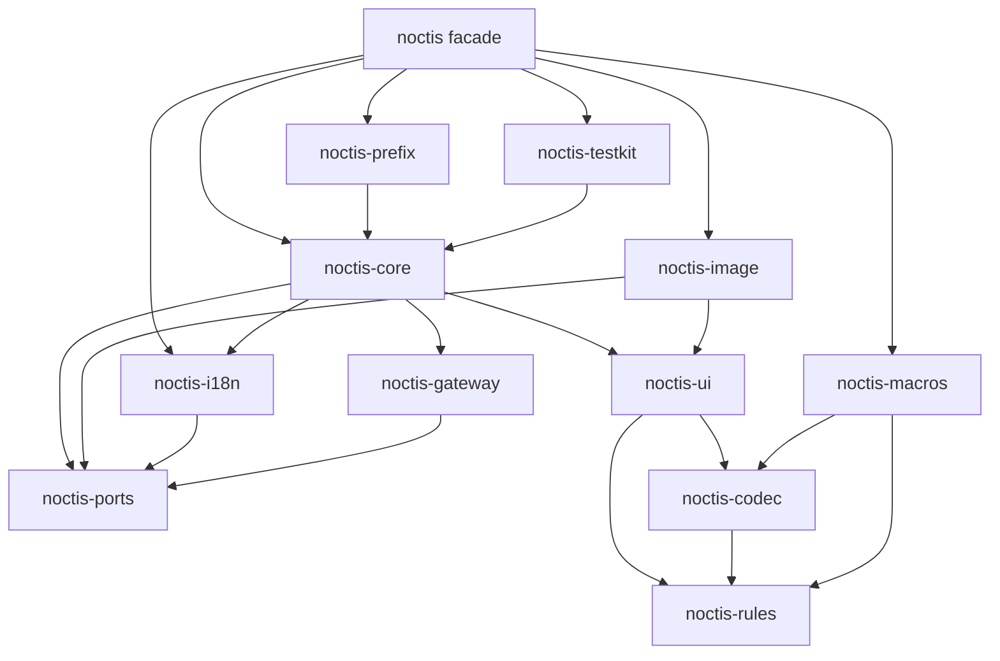
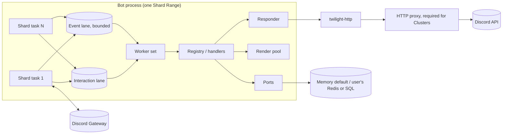

# Architecture Spine: Noctis

## Design Paradigm

The core is **hexagonal**. Domain logic covers the registry, routing, the UI model,
the codec and rules. It sits in pure crates with no I/O. Every storage-like concern
is a **port**, an Adapter trait in `noctis-ports`, and in-memory adapters are the
defaults. Discord I/O (gateway, HTTP) is a driving or driven adapter at the edge.

The runtime around the core is **event-driven and lane-based**. Shard tasks feed
bounded lanes, and a worker set drains them into handlers.

| Layer | Crates | May do I/O |
| --- | --- | --- |
| Rules and pure domain | `noctis-rules`, `noctis-codec`, `noctis-ui` | no |
| Ports | `noctis-ports` (traits plus in-memory defaults) | defaults only, in memory |
| Application | `noctis-core`, `noctis-i18n`, `noctis-prefix` | through ports and twilight-http only |
| Edge adapters | `noctis-gateway` (twilight-gateway), `noctis-image` (takumi) | yes |
| Compile time | `noctis-macros` | no (reads locale files) |
| Facade | `noctis` | — (re-exports only) |
| Tooling | `noctis-testkit`, `xtask` | test and CI only |

## Invariants & Rules



Arrows point from dependent to dependency. No edge may point upward, and no crate may
depend on `noctis` or `noctis-testkit` except examples and tests.

### AD-1 — Hexagonal core; storage only through ports [ADOPTED]
- **Binds:** all crates; FR-38, FR-39 and every Adapter FR.
- **Prevents:** a feature persisting state its own way (a static `HashMap`, a direct
  Redis call) that a bot author can't swap.
- **Rule:**
  - Every storage-like concern is a trait in `noctis-ports`, with a bounded
    in-memory default in `noctis_ports::memory`. This covers anything that stores,
    caches, queues or resumes data that must outlive one call.
  - Framework code may hold such data only through a port.
  - A new concern adds a new port; it doesn't extend an unrelated one.

### AD-2 — `noctis` is the only public API [ADOPTED]
- **Binds:** all crates; FR-48 and FR-50.
- **Prevents:** bot code depending on internal crates, version skew between
  sub-crates, and API drift the Usage Skill doesn't describe.
- **Rule:**
  - Bot code depends only on `noctis`. Every capability is a cargo feature of
    `noctis`, and every public item is re-exported from it.
  - All workspace crates share one version (`version.workspace = true`) and are
    released together.
  - Sub-crate docs say "internal; use `noctis`".
  - twilight is re-exported as `noctis::twilight`.

### AD-3 — One rules crate, used at compile time and at run time
- **Binds:** `noctis-rules`, `noctis-macros`, `noctis-ui`, `noctis-core`; FR-24,
  FR-75 to FR-79, NFR-10.
- **Prevents:** a macro and a runtime validator disagreeing about a Discord limit,
  and rules that never reach the catalog.
- **Rule:**
  - Every Discord limit and rule lives once, in `noctis-rules`. That crate is sync
    and side-effect-free, and its only dependency outside std is `unicode-ident` or
    an equivalent.
  - Each rule has the stable id from `docs/discord-rules.md` (`<AREA>-<nn>`, for example `CID-01`, `CMD-11`), used in `docs/discord-rules.md`, in
    error messages and in its tests.
  - Limit values sit in one `Limits` struct with Discord's defaults. Callers can
    override it at run time; macros use the defaults.
  - Proc macros call `noctis-rules` functions directly. They never copy a constant.

### AD-4 — Enforcement ladder
- **Binds:** every rule; FR-75 to FR-79.
- **Prevents:** a static mistake surfacing only in production, or a dynamic check
  being skipped because "the macro handles it".
- **Rule:** each rule is checked at the earliest stage its input is known:
  - **Compile time:** types, `const` asserts or proc macros, for literals and
    fixed-shape data.
  - **App-build:** `App::build`, before any connection, for anything that depends
    on combining Modules (merged commands, duplicate Routes, Routes with no
    handler).
  - **Runtime:** only for data built at run time.

  Compile-time checks have `trybuild` compile-fail tests. App-build and runtime
  checks have unit tests. Every test names its rule id.

### AD-5 — `custom_id` wire format
- **Binds:** `noctis-codec`, `noctis-macros`, `noctis-core`; FR-15 to FR-19,
  FR-75.
- **Prevents:**
  - length miscounts from non-ASCII characters;
  - two encoders producing incompatible ids;
  - a guessable or ambiguous Ref.
- **Rule:**
  - A `custom_id` is ASCII only. The format is
    `<ver><route>:<field>(,<field>)*`.
  - `<ver>` is one base62 character, which lets the format evolve.
  - `<route>` is the Route's short id, `[a-z0-9-]{1,24}`, unique per App.
  - Fields are base62 integers or snowflakes, single-character enums and booleans,
    or escaped strings. The escape character is `!`.
  - A Ref takes the place of the field list. It is `~` followed by 11 base62
    characters from a CSPRNG (≥64 bits).
  - Decoding is total: malformed input gives `CodecError`, never a panic.
  - The codec is the only code that builds or parses a `custom_id`.

### AD-6 — Payload length is a compile-time property
- **Binds:** `noctis-codec`, `noctis-macros`; FR-16, FR-17, FR-75.
- **Prevents:** a Route that overflows 100 characters only for some values, in
  production.
- **Rule:**
  - The `Payload` trait has `const MAX_ENCODED_LEN: Option<usize>`. `None` means
    unbounded.
  - `#[derive(Payload)]` computes the bound from field types. Bounded strings use
    `BoundedStr<N>`.
  - `#[derive(Route)]` emits
    `const _: () = assert!(ver + route + 1 + max ≤ 100)`.
  - A `None` or oversized Route must say `#[route(by_ref)]` or
    `#[route(overflow = "spill")]`; otherwise it doesn't compile.
  - With `by_ref`, the encoded length is the constant `ver + route + 1 + 12`.

### AD-7 — Registry is data, built once
- **Binds:** `noctis-core`, `noctis-macros`; FR-7 to FR-9, FR-15, FR-44, FR-45,
  FR-56.
- **Prevents:** order-dependent registration side effects, O(n) dispatch, and
  merge rules that differ between publish and dispatch.
- **Rule:**
  - Modules produce **descriptors** (commands, Routes, event handlers,
    middleware), which are plain data.
  - `App::build` folds all descriptors into one immutable `Registry`. It performs
    every App-build check and returns all errors at once.
  - Dispatch uses only the Registry's O(1) maps.
  - Publish JSON is generated only from the Registry.
  - Enabling or disabling a Module never rebuilds the Registry. It flips a
    per-Module bit, which is resolved through `ModuleStateStore` with a local cache.
  - Swapping the Registry at run time uses `arc-swap`.

### AD-8 — Command Patterns expand in the macro
- **Binds:** `noctis-macros`, `noctis-rules`; FR-7, FR-8, FR-9, FR-76.
- **Prevents:** a pattern that is legal in code but illegal on Discord, for example
  `config (set|get) (prefix|welcome)?`, where `set` is both a subcommand and a
  group.
- **Rule:**
  - `command!`/`#[command("…")]` expands the pattern at compile time with
    `noctis_rules::command::expand`, then calls
    `noctis_rules::command::validate_tree` on the result. That function checks
    word count, the name regex, mixing leaves with groups, and option ordering.
  - Violations are `compile_error!`s that name the rule id.
  - Conflicts between Modules are checked by the same `validate_tree` at App-build.

### AD-9 — Handlers are stateless; state is ports or typed app state
- **Binds:** `noctis-core`, all handler-facing APIs; NFR-2, UD-7.
- **Prevents:** a per-message listener, closure or timer, and hidden global mutable
  state.
- **Rule:**
  - A handler is an `async fn` taking the context, the decoded Payload or options,
    and injected `State<T>`, `Ext<T>` and port handles.
  - The framework never stores a closure, task or timer per message or component.
  - Interactive state travels in Payloads and Refs, or the bot keeps it behind a
    port.
  - Mutable shared bot state goes in `State<T>` registered at build. There are no
    `static mut` items and no global singletons.

### AD-10 — Runtime lanes and back-pressure
- **Binds:** `noctis-gateway`, `noctis-core`; FR-2 to FR-6, FR-21, NFR-3, NFR-4.
- **Prevents:** a slow handler stalling heartbeats, interactions missing the 3 s
  deadline under event load, and unbounded memory growth.
- **Rule:**
  - Each Shard runs in its own tokio task. That task only reads, filters,
    deserializes and enqueues; it never awaits a handler.
  - Interactions go to the **interaction lane**. It has priority, is never dropped,
    and is exempt from event back-pressure.
  - Other events go to the bounded **event lane**. When it is full, the shard task
    applies back-pressure and the metric records it.
  - A semaphore-bounded worker set drains both lanes, interaction lane first.
  - CPU-heavy work goes to the render pool or `spawn_blocking`. Nothing blocks on
    the async runtime.

### AD-11 — The Responder owns every reply
- **Binds:** `noctis-core`, `noctis-ui`; FR-21, FR-22, FR-29, FR-23.
- **Prevents:** double acknowledgements, a modal sent after a defer, a V2 message
  edited without the flag, and ephemerality changing mid-flow.
- **Rule:**
  - All replies go through `Responder`. It is a state machine:
    `Unacked → (Modal | Deferred | Responded) → Edited*`.
  - Ephemerality and "may open a modal" are declared when the handler is
    registered. Auto-defer is off for handlers that may open a modal.
  - The Responder adds `IS_COMPONENTS_V2` to every V2 send and edit, and attaches
    tracked attachments.
  - A transition that isn't legal is an error, not a silent no-op.

### AD-12 — Noctis owns the Components V2 model
- **Binds:** `noctis-ui`, `noctis-core`; FR-23 to FR-31, FR-52 and up (V2 and
  modal FRs).
- **Prevents:** being blocked by twilight-model gaps (Radio Group and Checkbox are
  missing, and unknown types are dropped), and two component models in one
  codebase.
- **Rule:**
  - `noctis-ui` defines the V2 message and modal component types. Placement rules
    are encoded in types: `ContainerChild`, `SectionAccessory`, an `ActionRow`
    enum, and separate message and modal select types.
  - These types serialize directly to Discord JSON, which is sent as a raw
    twilight-http body.
  - twilight-model is used only for ids, interactions, events and commands.
  - Incoming component data that Noctis doesn't model is kept as
    `serde_json::Value`, never dropped.

### AD-13 — Error model
- **Binds:** all crates; FR-19, FR-22, NFR-4.
- **Prevents:** stringly errors, panics escaping into the runtime, and
  incompatible error shapes between crates.
- **Rule:**
  - Each crate has its own `thiserror` enum.
  - The facade exposes `noctis::Error` (`#[non_exhaustive]`), which wraps them.
  - Handlers return `Result<_, HandlerError>`. `HandlerError` carries a source and
    an optional localized user message key.
  - Every handler and event future runs under `catch_unwind`. A panic becomes an
    error-sink event.
  - Library code never uses `unwrap`/`expect` on external input.

### AD-14 — Port shape
- **Binds:** `noctis-ports`, all adapter implementers; FR-38, FR-39, FR-60.
- **Prevents:** generic type explosion on `App`, adapters with incompatible
  semantics, and serialization mismatches between processes.
- **Rule:**
  - Port traits are `Send + Sync + 'static` and dyn-compatible. Async methods
    return `BoxFuture<'_, Result<T, PortError>>`.
  - The App holds `Arc<dyn Port>`.
  - Store ports operate on keys plus `Bytes` values with TTL. Typed access is a
    wrapper in `noctis-core`, which serializes with postcard.
  - Keys are namespaced `"{app}:{port}:{key}"`.
  - Each port ships a conformance suite in `noctis-testkit`. The in-memory
    defaults must pass it, and so must any third-party adapter.

### AD-15 — Rendering pipeline
- **Binds:** `noctis-image`, `noctis-macros`; FR-32 to FR-37 and the render FRs
  added in revision.
- **Prevents:**
  - renders blocking the runtime;
  - unbounded render memory;
  - Tailwind classes that pass validation but render differently;
  - any Node or Tailwind-CLI tooling.
- **Rule:**
  - Templates are built with `view!`/`tw!` macros. These validate literal classes
    with takumi's own Rust parser, behind the macro's `image` feature.
  - Renders run on a dedicated rayon pool behind a bounded queue. A full queue
    means a typed error.
  - Results are cached through the `RenderCache` port. The key is
    `blake3(template_id, template_version, postcard(data), size, format)`.
    Concurrent identical requests share one render.
  - Remote images are fetched only through `AssetStore`, never by takumi.

### AD-16 — Localization is compiled
- **Binds:** `noctis-i18n`, `noctis-macros`; FR-41 to FR-43.
- **Prevents:**
  - runtime "missing key" surprises;
  - placeholder mismatches;
  - command names and content using different sources.
- **Rule:**
  - `i18n!("locales")` compiles the locale files into typed accessors at compile
    time.
  - A key missing from the default locale is a compile error. Other locales fall
    back with a build warning.
  - Command localizations are read from the same files.
  - `LocaleSource` (a port) can overlay values at run time but can't add keys.

### AD-17 — Project Template tracks the public API
- **Binds:** `examples/project-template`, `xtask`, CI; FR-49, FR-50.
- **Prevents:** the Noctis Usage Skill drifting from the real API, so agents read
  Noctis source or write code that doesn't compile.
- **Rule:**
  - `xtask api-snapshot` records the facade's public API (`cargo public-api`).
  - `xtask skill-check` fails CI if a public item isn't mentioned in
    `examples/project-template/.claude/skills/noctis/`, or if the snapshot changed
    and the skill's recorded API hash didn't.
  - CI builds the template against the workspace.

## Consistency Conventions

| Concern | Convention |
| --- | --- |
| Crate naming | `noctis-<area>`, lib name `noctis_<area>`; facade feature names equal the area (`image`, `prefix`, `i18n`, `testkit`), plus `image-gif`, `image-emoji` and `default-font` |
| Route ids | `[a-z0-9-]{1,24}` ASCII, set by `#[route("id")]` and stable across releases; renaming one invalidates live components and counts as a breaking change for the bot |
| Module ids | path-like `a/b/c`, unique per App |
| Rule ids | `<AREA>-<nn>` as assigned in `docs/discord-rules.md` (for example `CID-01`, `CMD-11`), shared by code, error messages, docs and tests; new rules get the next number, ids are never reused |
| Errors | `thiserror` enum per crate, named `<Area>Error`; never `Box<dyn Error>` in public APIs |
| Async | tokio only; public async APIs are `async fn` or return `impl Future + Send`; no blocking calls in async |
| Logging and metrics | `tracing` spans `noctis.shard`, `noctis.interaction`, `noctis.event`, `noctis.render`; metrics through the `metrics` facade, names prefixed `noctis_`; tokens never logged |
| Ids and time | twilight `Id<Marker>` everywhere; durations are `std::time::Duration`; timestamps are UTC |
| Serialization | Discord JSON with serde; port values with postcard; custom_id with `noctis-codec` only |
| Config | builder API in code, plus `App::from_env()` reading `NOCTIS_*` variables; no config files required |
| Features | additive only, and the default features build a working bot |
| Docs | every public item has rustdoc, and runnable examples are doctests |
| Tests | each rule id has a test tagged with its id; ports pass their conformance suite; Views are snapshot-tested with `insta` |

## Stack

| Name | Version |
| --- | --- |
| Rust (MSRV / edition) | 1.91 / 2024 |
| tokio | 1.53 |
| twilight-gateway / -http / -model / -cache-inmemory / -http-ratelimiting | 0.17.1 |
| takumi | 2.17.0 (pinned exact) |
| serde / serde_json | 1.0 |
| postcard | 1.1 |
| thiserror | 2.0 |
| tracing / metrics | 0.1.44 / 0.24 |
| arc-swap | 1.9 |
| moka (memory adapters) | 0.12 |
| rayon | 1.12 |
| blake3 | 1.8 |
| bytes | 1.12 |
| syn / quote (macros) | 3.0 / 1.0 |
| trybuild / insta / proptest | 1.0 / 1.49 / 1.12 |

## Structural Seed

```text
noctis-rs/
  Cargo.toml                 # [workspace], shared version, [workspace.dependencies], [workspace.lints]
  crates/
    noctis/                  # facade: re-exports + features
    noctis-rules/            # Discord limits & validators (DR ids), Limits struct
    noctis-codec/            # custom_id format, Payload trait, Ref keys, BoundedStr
    noctis-ui/               # V2 + modal model, builders, validator, View/Navbar/Wizard/Paginator
    noctis-ports/            # port traits + memory defaults
    noctis-gateway/          # shard supervision, lanes, identify queue, session resume
    noctis-core/             # App, Module, Registry, dispatch, Responder, middleware, publish, State/Ext
    noctis-macros/           # command!, derive(Payload/Route/Options/Modal), view!/tw!, i18n!
    noctis-i18n/             # locale runtime, Discord locale mapping
    noctis-image/            # takumi renderer, render pool, fonts/assets, animation
    noctis-prefix/           # opt-in prefix commands (P2)
    noctis-testkit/          # simulated interactions, port conformance suites, snapshot helpers
  examples/
    project-template/        # standalone bot + AGENTS.md + .claude/skills/{noctis,rust-best-practices}
    <feature>/               # small focused examples
  docs/
    discord-rules.md         # rules catalog: rule, limit, source, enforcement point
  xtask/                     # api-snapshot, skill-check, rules-catalog check
  .github/workflows/ci.yml   # fmt, clippy -D warnings, test, trybuild, doc, public-api, skill-check, template build
```



**Deployment envelope:**
- **Unit of deployment:** one binary. A single process runs every shard; a Cluster
  runs N processes, each with a Shard Range.
- **Shared services in a Cluster:** shared ports (Redis/SQL adapters written by the
  user), a shared HTTP proxy, and the `IdentifyQueue` port.
- **Publishing:** exactly one process has `publisher = true`.
- **Environments:** dev uses guild-scoped Publish to a test guild; prod uses global
  Publish. `--publish` is a CLI mode of the same binary.

## Capability → Architecture Map

| Capability / Area | Lives in | Governed by |
| --- | --- | --- |
| App lifecycle, sharding, resume (FR-1 to FR-6) | noctis-gateway, noctis-core | AD-10, AD-14 |
| Commands, patterns, Publish (FR-7 to FR-14, FR-56) | noctis-macros, noctis-rules, noctis-core | AD-7, AD-8, AD-4 |
| Routes, Payloads, Refs, middleware, auto-ack (FR-15 to FR-22) | noctis-codec, noctis-core | AD-5, AD-6, AD-9, AD-11 |
| V2 UI kit, Views, Navbar, Wizard, Paginator, modals (FR-23 to FR-31, V2 additions) | noctis-ui | AD-12, AD-3, AD-11 |
| Rendering (FR-32 to FR-37, render additions) | noctis-image, noctis-macros | AD-15 |
| Adapters (FR-38 to FR-40, port additions) | noctis-ports, noctis-testkit | AD-1, AD-14 |
| Localization (FR-41 to FR-43) | noctis-i18n, noctis-macros | AD-16 |
| Modules, flags, rate limits, multi-App (FR-44 to FR-47) | noctis-core | AD-7, AD-1 |
| Facade, template, skill, testkit (FR-48 to FR-51) | noctis, examples, xtask, noctis-testkit | AD-2, AD-17 |
| Compile-time enforcement and rules catalog (FR-75 to FR-79, NFR-10) | noctis-rules, noctis-macros, docs | AD-3, AD-4, AD-6, AD-8 |

## Deferred

- **Official Redis/SQL adapter crates:** v1.x. The port shape (AD-14) and the
  conformance suites make them additive.
- **Cross-process request bus and live resharding:** deferred until a Cluster
  deployment needs them. The `IdentifyQueue` and `SessionStore` ports already cover
  restarts.
- **Remote render service:** only the `Renderer` seam exists in v1.
- **twilight 0.18 migration (`bucket()` API):** handled in `noctis-gateway` alone
  when 0.18 ships, without facade changes.
- **Exact `Limits` values still open:** the 4000-character counting unit, the
  maximum length of a single Text Display, and media URL length. They default
  conservatively, and the open questions are tracked in `docs/discord-rules.md`.
- **Internal module layout of each crate:** owned by the code.
