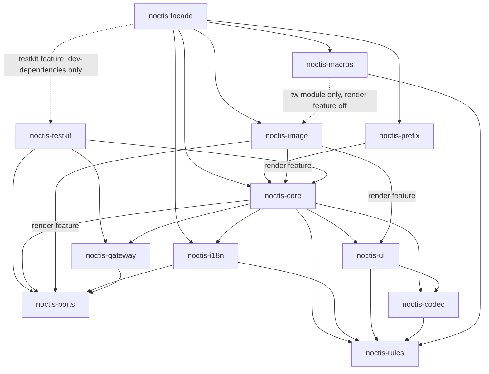
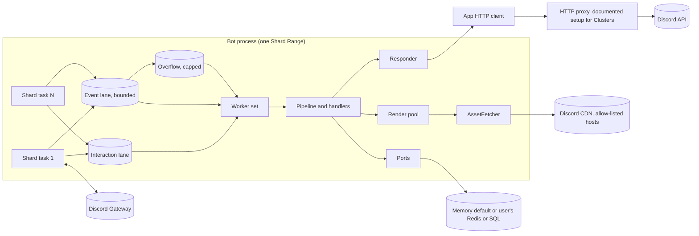

# Architecture Spine: Noctis

## Design Paradigm

The core is **hexagonal**. Domain logic (rules, codec, UI model) sits in pure crates
with no I/O. Every storage-like concern is a **port** in `noctis-ports` with a bounded
in-memory default. Discord I/O is concentrated in two adapters: the gateway (a driving
adapter that `noctis-core` starts and owns) and the App's single twilight-http client
(a driven adapter that `noctis-core` owns). Rendering is a driven port (`Renderer`)
implemented by `noctis-image`. Optional crates above core (`noctis-image`,
`noctis-prefix`) attach to an App only through core's `Plugin` seam (AD-24).

The runtime around the core is **event-driven and lane-based**. Shard tasks feed
lanes; a worker set in `noctis-core` drains them into handlers.

| Layer | Crates | I/O |
| --- | --- | --- |
| 0 Rules | `noctis-rules` | none |
| 1 Wire and ports | `noctis-codec`, `noctis-ports` | none (memory defaults only) |
| 2 UI model | `noctis-ui` | none |
| 3 Edge and services | `noctis-gateway`, `noctis-i18n` | gateway socket |
| 4 Application | `noctis-core` (incl. `Runtime`, `Plugin`, `Dispatcher`) | Discord HTTP through the App's one client; storage through ports |
| 5 Extensions | `noctis-image` (`render` feature), `noctis-prefix`, `noctis-testkit` | image asset fetch and render pool; the rest through core |
| 6 Facade | `noctis` | none (re-exports, feature wiring) |
| Compile time | `noctis-macros` (proc-macro) | reads the invoking crate's locale and theme files |

`noctis-image` with its `render` feature off (its default) is only the takumi-free
`tw` grammar module and has no workspace dependency, so `noctis-macros` can use it;
the `render` feature adds takumi and the edges to `noctis-core`, `noctis-ports` and
`noctis-ui`. The facade's `image` feature turns `render` on. Resolver 3 keeps
proc-macro dependencies' features apart from normal ones, so `noctis-macros`' copy of
`noctis-image` always builds with `render` off.
| Tooling | `xtask` | CI and release only |

## Invariants & Rules



Arrows point from dependent to dependency. The drawn edges are the only allowed
workspace edges, except that the facade may depend on any crate. Every edge points to
a lower layer; a labelled edge exists only with that feature on. There is no
`noctis-testkit → noctis-image` edge: the testkit reaches rendering only through the
`Renderer` port an App's `ImagePlugin` installed (AD-24). No crate depends on `noctis`, except internal crates' own tests through
`[dev-dependencies]`. Only the facade's `testkit` feature, which bot crates enable in
`[dev-dependencies]` only, reaches `noctis-testkit`. `xtask deps-check` enforces this
list in CI.

### AD-1 — Hexagonal core; storage only through ports [ADOPTED]
- **Binds:** all crates; FR-38 to FR-40, FR-71 and every Adapter FR.
- **Prevents:** a feature persisting state its own way (a static `HashMap`, a direct
  Redis call) that a bot author can't swap, or that breaks under a Cluster.
- **Rule:**
  - Every storage-like concern is a trait in `noctis-ports`, with a bounded
    in-memory default in `noctis_ports::memory`. This covers anything that stores,
    caches, queues or resumes data that must outlive one call.
  - The v1 ports are `RefStore`, `SessionStore`, `IdentifyQueue`,
    `ModuleStateStore`, `RateLimitStore`, `CacheStore`, `DiscordCache`,
    `RenderCache`, `AssetStore`, `LocaleSource` and `GuildAccessList`. `Renderer`
    is a driven port in the same crate, not a store (AD-22).
  - `CacheStore` is the general key-value store with TTL that bots and Modules use,
    reached through the typed, namespaced `ctx.kv()` handle (`get`, `put`,
    `put_if_absent`, `incr`, `counter`, `delete`). It never backs the Discord cache.
  - `DiscordCache` is a separate port for Discord resources (guilds, channels,
    roles, members, users, messages). Its default in `noctis_ports::memory` wraps
    `twilight-cache-inmemory`, limited to the resource types the App needs (AD-21)
    and to twilight's per-channel message cap; its memory is reported apart from
    framework memory (NFR-1). Handlers read it through `ctx.cache()`.
  - Framework code may hold such data only through a port. A new concern adds a new
    port; it doesn't extend an unrelated one.
  - Exempt: twilight-http's transport rate-limiter state, per-connection gateway
    state (heartbeat, send limiter) and in-flight coordination that dies with its
    request (render single-flight). `RateLimitStore` holds only author-declared
    FR-46 limits.

### AD-2 — `noctis` is the only public API [ADOPTED]
- **Binds:** all crates; FR-48, FR-50, NFR-7.
- **Prevents:** bot code depending on internal crates, version skew between
  sub-crates, macro output that only compiles in one crate, and API drift the Usage
  Skill doesn't describe.
- **Rule:**
  - Bot code depends only on `noctis`. Every capability is a cargo feature of
    `noctis`, and every public item is re-exported from it.
  - All workspace crates share one version (`version.workspace = true`) and are
    released together (AD-28). Sub-crate docs say "internal; use `noctis`".
  - twilight is re-exported as `noctis::twilight`. Renderer types are reachable only
    through `noctis::image::unstable`, which semver doesn't cover.
  - Feature crates add builder methods through extension traits that the facade
    re-exports, and `noctis::prelude` includes them when their feature is on
    (`noctis::image::AppBuilderImageExt` with `image`); they install a `Plugin`
    (AD-24).
  - Macro output names runtime items only through `::noctis::__private::<crate>`
    paths. Internal crates that use derives in their own tests either dev-depend on
    `noctis` or pass `#[noctis(crate = path)]`.

### AD-3 — One rules crate, used at compile time and at run time
- **Binds:** `noctis-rules`, `noctis-macros`, `noctis-ui`, `noctis-core`; FR-24,
  FR-75 to FR-79, NFR-10.
- **Prevents:** a macro and a runtime validator disagreeing about a Discord limit,
  rules that never reach the catalog, and packers and validators using different
  Limits.
- **Rule:**
  - Every Discord limit and rule lives once, in `noctis-rules`. The crate is sync,
    does no I/O and has no async. It may depend on small pure crates (`regex` with
    Unicode tables for CMD-01).
  - Each rule has the stable id from `docs/discord-rules.md` (`<AREA>-<nn>`, for
    example `CID-01`), used in the catalog, in error messages and in its tests.
  - Limit values sit in one `Limits` struct with Discord's defaults and a
    `mode: Strict | Lenient` (default Strict). Lenient truncates text with `…` and
    warns; it never applies to structural rules (CV2-03, CV2-05, CV2-06, CID-01,
    CID-02). Autocomplete suggestions are always truncated to 25, and their labels
    to 100 characters, with a warning.
  - Every function that measures, packs or validates takes `&Limits`.
    `Limits::default()` is called only by App builder defaults, macros and tests.
  - Macros check against the defaults. A runtime override that lowers a limit makes
    the runtime validator check every tree, static ones included; an override that
    raises a limit never relaxes a compile-time check.
  - `noctis_rules::len::discord_len` (the larger of scalar values and UTF-16 units)
    is the only length function for user text.
  - Proc macros call `noctis-rules` functions directly. They never copy a constant.

### AD-4 — Enforcement ladder
- **Binds:** every rule; FR-75 to FR-79, NFR-10.
- **Prevents:** a static mistake surfacing only in production, or a dynamic check
  being skipped because "the macro handles it".
- **Rule:** each rule is checked at the earliest stage its input is known:
  - **Compile time:** types, typestate, `const` asserts or proc macros, for literals
    and fixed-shape data.
  - **App-build:** `App::build`, before any connection, for anything that depends
    on combining Modules (merged commands, duplicate Routes, Routes with no handler,
    Locale key clashes, missing Extensions, intents). It returns every violation at
    once.
  - **Runtime:** only for data built at run time.

  A compile-time check must fail under `cargo check`, because trybuild runs
  compile-fail suites with `cargo check`. The allowed mechanisms are proc-macro
  errors, trait bounds, free `const _` items over concrete types, and construction
  (the illegal value or call has no API):
  - Placement and arity rules are traits implemented only for legal shapes (for
    example the array-length trait behind `ActionRow::buttons([b; N])` exists only
    for `N` in 1..=5). Each such trait carries
    `#[diagnostic::on_unimplemented(message = "[<RULE-ID>] …")]`, so the rule id
    reaches the error text.
  - Literal text goes through a proc macro (`label!("…")`, `rgb!(…)`, attribute
    literals) that measures it with `noctis-rules` at expansion.
  - Literal Components V2 trees go through `components!` (`noctis-macros`, AD-12),
    which counts components and literal text, checks placement and arity, and
    rejects duplicate literal `(Route, Payload)` pairs (CID-02) at expansion.
  - **By construction:** the type has no field, method, variant or constructor for
    the illegal thing (`V2Message` has no `content`; `Responder<Acked>` has no
    `reply`), so rustc's own error (E0599, E0609, E0382, …) rejects it and can't
    carry the rule id. The catalog marks these rows `Compile-time (by construction)`.
  - A `const` assertion inside generic code is evaluated only at monomorphization
    (`cargo build`), so it is never the enforcement point of a rule.

  Compile-time checks have compile-fail tests. For a check that Noctis diagnoses
  (proc macro or `on_unimplemented`), the trybuild fixture's `.stderr` contains
  `[<RULE-ID>]`. For a by-construction rule, the evidence is a `compile_fail` doctest
  or a trybuild fixture whose source carries `// [<RULE-ID>]` on the offending line;
  its `.stderr` is rustc's own error. App-build and runtime checks have unit tests.
  Every test names its rule id, and `xtask rules-catalog` fails CI when a
  Compile-time, App-build or Runtime row has no test of the kind its tier requires.

### AD-5 — `custom_id` wire format
- **Binds:** `noctis-codec`, `noctis-core`, `noctis-ui`, `noctis-macros`; FR-15 to
  FR-19, FR-25, FR-60, FR-76; CID-01 to CID-07.
- **Amended (2026-10-20):** the View envelope `E` and the `view` Route shape are
  withdrawn with AD-20 (maintainer decision: no UI widgets). Tab, page and step ids
  are ordinary Payload fields. Story 6.10 removes the shipped `E` code.
- **Prevents:**
  - length miscounts from non-ASCII characters;
  - two encoders producing incompatible ids;
  - stale ids decoding as wrong data after a deploy;
  - guessable, forged or cross-Route Refs.
- **Rule:**
  - A `custom_id` is ASCII only. This layout is normative; `docs/discord-rules.md`
    quotes it:

    ```text
    custom_id = F route ":" [S] [N] body [T]

    F      1 char    base62 digit = 16 * generation + flags
                     flags: 1 = S present, 2 = reserved (must be 0), 4 = N present,
                     8 = T present
                     v1 writes generation 0 (F < 16); F >= 16 or flag 2 set is a
                     CodecError
    route  1..24     [a-z0-9._-], unique per App; ids starting with "_" are reserved
    S      1 char    Route schema version 1..=61 (`schema = n` on the kind attribute); absent = 0
    N      2 chars   per-render select nonce (FR-25); select Routes only
    body   inline    field ("," field)*
           by ref    "~" + 11 base62 Ref
    T      6 chars   integrity tag: base62 of truncated keyed BLAKE3 over all
                     preceding chars; inline bodies of `signed` Routes only
    ```

  - Decoding is total: malformed input gives `CodecError`, never a panic. A flag set
    that doesn't match the Route's declared shape, or an `S` that differs from the
    Route's schema, decodes as `Stale` (FR-60) and goes to the Route's stale handler,
    else the Expired Handler. An unknown route or a bad tag is forged and takes the
    unknown-Route path (FR-19).
  - Appending `Option<T>` fields is compatible: missing trailing fields decode as
    `None`, with no schema bump. Every other Payload change, and changing a Route's
    `select`, `signed` or `by_ref` shape, bumps `schema`. Renaming a Route id
    breaks live components.
  - Fields are base62 integers (signed ones zig-zag), snowflakes, 1-char enums and
    booleans, `Option` with a 1-char presence tag, and `BoundedStr<N>` (ASCII only,
    escape character `!`). Inline bodies and Ref records use the same field encoding.
  - A Ref is 11 base62 characters from the OS CSPRNG (`getrandom`, ≥ 64 bits),
    never sequential and never derived from interaction data. It resolves to a
    `RefRecord { route, schema, payload }` encoded by the codec. Core rejects a
    record whose route differs from the id's route (forged) and sends a schema
    mismatch to `Stale`.
  - The integrity key is `NOCTIS_PAYLOAD_KEY` (32 bytes), identical across a
    Cluster. One previous key may be configured for verification during rotation.
    It is never logged and never passed to an adapter.
  - The codec is the only code that builds or parses a `custom_id`. Its layout
    constants (`FMT_LEN`, `SEP_LEN`, `SCHEMA_LEN`, `NONCE_LEN`,
    `REF_MARKER_LEN`, `REF_LEN`, `TAG_LEN`) are `pub const`, and
    `xtask rules-catalog` asserts the catalog quotes the same values.

### AD-6 — Payload length is a compile-time property
- **Binds:** `noctis-codec`, `noctis-macros`; FR-16, FR-17, FR-76; CID-01.
- **Amended (2026-10-20):** the `view` codec argument and the `E` term are
  withdrawn with AD-20; `#[route]` rejects `view` as an unknown argument (CID-03)
  once Story 6.10 lands.
- **Amended (2026-10-21):** the runtime arguments `ttl = "<duration>"` and
  `one_shot` (Story 7.5) are accepted on by-Ref Routes only (`by_ref` or
  `overflow = spill`; CID-03 otherwise). A duration is `<digits><unit>` groups with
  the units `d`, `h`, `m`, `s`, each at most once and in that order, totalling
  1 s..=365 d. The derive records them in `DeclaredRuntime::RUNTIME`, and
  `noctis_ui::Handled` gains the supertrait `DeclaredRuntime` so the policy reaches
  both the encoder and dispatch; `Route` itself is unchanged.
- **Amended (2026-10-21):** the Route Guards `owner = field`, `permissions = A | B`
  and `guard = path::to::fn` (Story 7.7) are accepted once each on all seven kind
  attributes, `#[modal]` included (a modal's `owner` must be a Payload field). They
  live in core, not in `RouteRuntime`: the checks need `ComponentCtx`,
  `ModalSubmitCtx` and `Permissions`, which codec cannot name, so the derive emits
  core's hidden `__Guards<Ctx>` impl (an RPITIT `__guard`, empty without a Guard)
  and `RouteRuntime` keeps only the Ref policy. The owner field's type is checked by
  rustc (`Id<UserMarker>` only); a custom Guard is
  `async fn(&Ctx, &Self) -> HandlerResult<Access>`.
- **Prevents:** a Route that overflows 100 characters only for some values, and a
  macro bound that disagrees with the real encoding.
- **Rule:**
  - Every field type implements `noctis_codec::Field { const MAX_LEN: Option<usize> }`,
    worst-case escaping included: `bool` 1, `u8`/`i8` 2, `u16`/`i16` 3,
    `u32`/`i32` 6, `u64`/`i64`/`Id<T>` 11, `#[derive(PayloadEnum)]` (≤ 62 variants)
    1, `Option<T>` `T + 1`, `BoundedStr<N>` `2N`, `String`/`Vec<T>` `None`. A bot
    type joins by implementing `Field`.
  - A kind derive (below) on a struct implements `Route` and `Payload` for it. It never
    inspects type names: it emits a `const` sum of `<F as Field>::MAX_LEN` plus
    `fields − 1` separators through codec `const fn`s. Generic Routes are rejected.
  - The bound is
    `MAX_LEN = FMT_LEN + route.len() + SEP_LEN + S + N + max(inline, by_ref)`,
    where `inline = Payload::MAX_ENCODED_LEN + T` and `by_ref = REF_MARKER_LEN + REF_LEN = 12`.
    `S`, `N` and `T` count only when the Route declares them (1, 2, 6).
  - One attribute per kind (amended 2026-10-20, maintainer decisions §7). A Route
    is declared by the derive that names its component kind: `#[derive(Button)]`
    with `#[button("id", …)]`, `#[derive(StringSelectMenu)]` with
    `#[string_select("id", …)]`, likewise `UserSelectMenu`/`user_select`,
    `RoleSelectMenu`/`role_select`, `MentionableSelectMenu`/`mentionable_select`,
    `ChannelSelectMenu`/`channel_select`, and `#[derive(Modal)]` with
    `#[modal("id", …)]` (the Payload is the fields without an input attribute). Each
    implements `Route` and `Payload` with the length proof below. (Shipped as
    `#[derive(Route)]` + `#[route("id", …)]`; Story 6.11 converts it, and the bare
    derive leaves the public authoring surface.) The attribute takes the id, then
    three kinds of arguments, and rejects anything else:
    - **Codec arguments** change the `custom_id` shape and length (Story 2.5):
      `by_ref` or `overflow = spill`, `schema = n` (1..=61) and `signed`. Every
      select kind carries the `N` nonce (the bare `select` argument is withdrawn by
      Story 6.11).
    - **Runtime arguments** don't change the encoding. `response = update |
      ephemeral | public` and `auto_defer = true | false` (Story 7.2; AD-11) ship on
      the component attributes as `__Component::RESPONSE` and the derive's
      `__Kind::Defer` (`Manual` for `auto_defer = false`), since `response` is a core
      concept and codec sits below core. (Amended 2026-10-21: `#[modal]` takes them
      too, carried by `__Modal::RESPONSE` and `__Kind::Defer`; Story 7.8.) The
      derive records the Ref-related arguments in an associated `RouteRuntime` const
      that core reads: `ttl = "…"` and `one_shot` (by_ref/spill Routes only; Story
      7.5), `owner = field`, `permissions = …` and `guard = path` (Route
      Guards; Story 7.7), and `rate_limit(..)` (Story 13.4). Each enters the derive
      in the story named. Expired and stale handling are `#[on_expired]` /
      `#[on_stale]` methods in the struct's `impl`, without `self` (Story 7.3).
      `opens_modal` is not an argument anywhere (AD-11).
    - **`defaults(..)`** is mandatory and holds the FR-59 component defaults (AD-19):
      Button needs `style` and `label` or `emoji` (`disabled`), selects need
      `placeholder` (`min_values`, `max_values`, `options = ChoicesEnum` for string
      selects, `default_values`), a modal needs `title`. A missing block or required
      key names the kind's required keys; an unknown key is a compile error; literal
      values are checked against Discord's limits (CV2-08, CV2-09, MOD-01, …).
  - The handler lives on its struct: `impl X { #[handler] async fn handle(self, ctx:
    …) }` for every kind (components, modals, `#[derive(SlashCommand)]`,
    `#[derive(UserCommand)]`, `#[derive(MessageCommand)]` and
    `#[derive(EventHandler)]` structs). `#[handler]` takes **no arguments**; `self` is
    the decoded value. Commands put `response = public | ephemeral`, `auto_defer`,
    `rate_limit(..)` and their metadata on `#[command]`, `#[user_command]` or
    `#[message_command]`; `#[autocomplete(field)]` methods take neither `response`
    nor `auto_defer`. Free-function handlers are not part of the API.
  - An inline Route whose bound is `None` or over 100 doesn't compile; `by_ref`
    with `signed` doesn't compile. A `spill` Route encodes inline when the actual
    value fits, else by Ref. FR-17's "error" overflow policy is this compile-time
    rejection of a plain inline Route; no runtime `overflow = error` exists.
  - With a 24-character route, the by-ref worst case is 46, so `by_ref` and `spill`
    Routes always fit.
  - The derive emits a free `const _: () = ::noctis::__private::codec::assert_fits::<T>();`
    and a `#[test]` that prints the width breakdown.

### AD-7 — Registry is data, built once
- **Binds:** `noctis-core`, `noctis-macros`; FR-7 to FR-9, FR-11, FR-13, FR-15,
  FR-44, FR-45, FR-47, FR-56 to FR-58, FR-73.
- **Prevents:** order-dependent registration side effects, O(n) dispatch, merge
  rules that differ between publish and dispatch, and Registry swaps racing
  dispatch.
- **Rule:**
  - Modules produce **descriptors** (commands, Routes, event handlers, middleware,
    hooks, locale catalogs), which are plain data.
  - Boot Flags (FR-73) and per-App restrictions (FR-47) filter descriptors before
    the fold, so unselected registrations are never registered, dispatched or
    published.
  - `App::build` folds the remaining descriptors into one immutable `Registry`,
    performing every App-build check. Base and group metadata declared by two
    Modules with different values is an error; undeclared metadata takes the value
    from the lexicographically first Module id and logs a warning (FR-57).
  - Dispatch uses only the Registry's O(1) maps. Publish JSON is generated only from
    the Registry.
  - The Registry is immutable for the App's life. Module enablement is a per-Module
    bitset (global plus per-guild overrides) cached from `ModuleStateStore` and
    refreshed on its version poll. `arc-swap` holds only that snapshot.

### AD-8 — Command Patterns expand in the macro
- **Binds:** `noctis-macros`, `noctis-rules`; FR-7 to FR-9, FR-56, FR-77.
- **Prevents:** a pattern that is legal in code but illegal on Discord, for example
  `config (set|get) (prefix|welcome)?`, and handlers receiving combinations in an
  order that differs between macro and runtime.
- **Rule:**
  - `#[command("…")]` expands the pattern at compile time with
    `noctis_rules::command::expand`, left to right in declaration order (FR-8). The
    cap is 25 expansions by default; `#[command(max_expansions = n)]` changes it.
    Duplicate expansions are rejected (CMD-15).
  - `noctis_rules::command::validate_tree` then checks name rules (CMD-01 to 03),
    at most 3 words (CMD-10), a name that is both leaf and group at one level
    (CMD-11), a base that is both invokable and has children (CMD-12), at most 25
    children per node (CMD-13) and the 8000 budget (CMD-05). Sibling groups and
    subcommands under one base are legal (CMD-14).
  - Violations are `compile_error!`s that name the rule id. Conflicts between
    Modules are checked by the same `validate_tree` at App-build.

### AD-9 — Handlers are stateless; state is ports or typed app state
- **Binds:** `noctis-core`, all handler-facing APIs; NFR-2, UD-7.
- **Prevents:** a per-message listener, closure or timer, and hidden global mutable
  state.
- **Rule:**
  - A handler is an `async fn handle(self, ctx, ..)` method on its struct (AD-6),
    taking the decoded Payload or options as `self`, the context, and injected
    `State<T>`, `Ext<T>` and port handles.
  - The framework never stores a closure, task or timer per message or component.
    Interactive state travels in Payloads and Refs, or the bot keeps it behind a port.
  - Mutable shared bot state goes in `State<T>` registered at build. There are no
    `static mut` items and no global singletons outside the process-scoped resources
    of AD-24.

### AD-10 — Runtime lanes and back-pressure
- **Binds:** `noctis-gateway`, `noctis-core`, `noctis-testkit`; FR-2 to FR-6,
  FR-21, NFR-3, NFR-4.
- **Prevents:** a slow handler stalling heartbeats, interactions missing the 3 s
  deadline under event load, unbounded memory growth, and gateway and core
  disagreeing on lane item shape or ordering.
- **Rule:**
  - Each Shard runs in its own tokio task. That task only reads, filters,
    parses and enqueues with `try_send`. It never awaits lane capacity or a handler.
  - `noctis-gateway` defines the lanes and the item
    `Inbound { shard, received_at: Instant, kind: Interaction(Box<Interaction>, RawJson) | Event(Box<Event>) }`.
    `RawJson` is the original `d` payload as `Bytes`, kept only for interactions.
    It is a gateway type (layer 3); crates below it never name it. Core hands its
    bytes (`RawJson::as_bytes() -> &[u8]`) to `noctis-ui`'s decoders (AD-12).
    `noctis-testkit` injects `Inbound` values into the same lanes, and its Discord
    fakes (AD-24) drive the real gateway and HTTP paths.
  - Interactions go to the **interaction lane**. It has priority, is never dropped,
    and is exempt from the event bound.
  - Other events go to the bounded **event lane**. When it is full, the event's
    type policy applies: droppable types (presence, typing and others marked
    droppable) drop the oldest queued event of a droppable type; other types go to a
    metered overflow buffer with a hard cap, beyond which they are dropped with an
    error log. Every drop is counted per event type.
  - `noctis-core` owns the semaphore-bounded worker set, which drains the
    interaction lane first. Event Handlers marked ordered run before the concurrent
    ones for that event, in per-guild order, through guild-keyed sub-queues (guild id
    hashed to a fixed sub-queue); all others run concurrently.
  - CPU-heavy work goes to the render pool or `spawn_blocking`. Nothing blocks the
    async runtime.

### AD-11 — The Responder owns every reply
- **Binds:** `noctis-core`, `noctis-ui`; FR-21 to FR-23, FR-29, FR-61, FR-65;
  INT-01 to INT-12, WH-01 to WH-03.
- **Prevents:** double acknowledgements, a modal sent after a defer, a V2 message
  edited without the flag, ephemerality changing mid-flow, and webhook sends that
  silently drop components.
- **Rule:**
  - Handler kinds have their own context types (`CommandCtx`, `ComponentCtx`,
    `ModalSubmitCtx`, `AutocompleteCtx`), so the kind fixes the legal callbacks at
    compile time (INT-04). `AutocompleteCtx` has no response method and no Responder:
    an `#[autocomplete(field)]` method returns `HandlerResult<Suggestions<T>>` and
    Noctis sends callback type 8 itself (maintainer decisions §8).
  - The full type is `Responder<K, S = Pending, D = AutoDefer>`. `K` is the handler
    kind: `Command`, `Component` or `ModalSubmit`; `D` is the sealed defer mode,
    `AutoDefer` (default) or `Manual`. A handler that responds explicitly takes it as
    a parameter through the aliases `CommandResponder<D = AutoDefer>`,
    `ComponentResponder<D = AutoDefer>` and `ModalResponder<D = AutoDefer>`; a
    handler that only sends a rendered message through its context (below) takes
    none. `Responder<Pending>` and `Responder<Acked>` in the rules below mean
    `Responder<K, Pending, D>` and `Responder<K, Acked, D>` for any `K` and `D`.
    (Amended 2026-10-20: the `M = NoModal | OpensModal` parameter of
    `Command<M>`/`Component<M>` and the `opens_modal` declaration are replaced by `D`
    and `auto_defer`; Story 6.10 converts the shipped code.)
  - Method names and semantics follow discord.js interaction responses.
    `Responder<Pending>` methods (`reply` type 4, `defer_reply` type 5, `update`
    type 7, `defer_update` type 6, `show_modal` type 9) consume `self` and return
    `Responder<Acked>`, which offers only `edit_reply`, `fetch_reply`,
    `delete_reply` (all on `@original`) and `follow_up(msg, Visibility) ->
    FollowupHandle` (INT-03); `done()` turns it into the `Responded` value the
    handler returns. `update`/`defer_update` exist only for `Component` and
    `ModalSubmit` (a modal not opened from a component message gets
    `UpdateUnavailable` at run time). `show_modal` exists only for
    `Responder<Command, Pending, Manual>` and `Responder<Component, Pending, Manual>`
    (INT-05): it is bounded by a sealed trait whose
    `#[diagnostic::on_unimplemented]` message reads `[INT-05] show_modal needs
    auto_defer = false on this handler` (and notes that a modal submit can never open
    a modal), so calling it on an `AutoDefer` responder or a `ModalResponder` is an
    E0277 compile error.
  - Every interaction handler declares `auto_defer = true | false` (default `true`)
    with its registration arguments: on `#[command]`, `#[user_command]` or
    `#[message_command]`, or on the kind attribute of a component or modal
    (`#[button(..)]`, `#[string_select(..)]`, `#[modal(..)]`, …; AD-6). `#[autocomplete]` rejects it (INT-06: autocomplete has no defer).
    The derive emits the mode as an associated type and the `#[handler]`
    method macro emits a trait-bound assertion between it and the responder parameter, so
    the INT-05 match below is still a compile error even though the two attributes
    are on different items. `auto_defer = false` arms no auto-defer for
    that handler; the handler may still call `defer_reply`/`defer_update`, and one
    that has not answered by the 3 s deadline logs an error naming it. The handler
    macro requires the `Manual` responder alias exactly when `auto_defer = false` is
    declared, and the reverse (any mismatch is an INT-05 compile error). The deadline
    stays App-wide (`AppBuilder::ack_deadline`, default 2000 ms).
  - A runtime state machine (an atomic shared by the handler and the auto-defer
    task) covers what types can't: when the auto-defer wins, a `Pending` call becomes
    `edit_reply`; follow-ups are counted (5 for user-installed apps, INT-11); after
    15 minutes calls return `TokenExpired` without an HTTP request (INT-02).
  - Each handler declares its default response at registration with one argument,
    `response = …`, checked at compile time; the auto-defer and the default
    ephemerality of `reply(msg)`/`defer_reply()` use it (`reply_as(msg, e)` and
    `defer_reply_as(e)` override per call). Commands and context menus: `public`
    (default) or `ephemeral`, auto-defer type 5 with only `EPHEMERAL` when declared
    (`update` is an INT-04 compile error). Components and component-opened modal
    submits: `update` (default, auto-defer type 6), `ephemeral` or `public`
    (auto-defer type 5, new message). A modal submit without a source message (a
    slash-opened modal) can only be `public` or `ephemeral`; since the opener is not
    known at compile time, a declared `update` there falls back to type 5 public for
    the auto-defer and `update`/`defer_update` return `UpdateUnavailable`. `response`
    is independent of `auto_defer`. The V2 flag goes on the edit (INT-08).
  - A View is a plain author-written function returning a message (FR-25); there is
    no View trait or registry and core never re-renders on its own. The handler
    context offers an ergonomic layer over the typestate (FR-61):
    `ctx.respond(msg)` (new message, or follow-up after a defer), `ctx.update(msg)`
    (edit the component's message; `Component`/`ModalSubmit` only; on a submit of a
    slash-opened modal, which has no message, it returns `UpdateUnavailable` without a
    request and never falls back to a new message: use `ctx.respond`) and
    `ctx.reply_text(text)` (a one-line notice, ephemeral by default). Each picks the
    callback type, defer variant and flags from the declared ephemerality and the
    runtime state machine, so the author never selects a response type. The Responder adds `IS_COMPONENTS_V2` to every V2 send and edit,
    finalizes Refs (AD-18) and attachments (AD-22), and runs the runtime validator.
  - **Amended (2026-10-21, Story 8.1):** every interaction context carries its run's
    responder state (`CtxInner::shared`), so the context methods and the typestate
    Responder share one gate. `ctx.respond` is type 4 with the declared ephemerality
    while unanswered, the edit of an unedited type-5 loading message (INT-12, keeping
    its ephemerality), and a follow-up with the declared visibility after a type-6
    defer or once answered. `ctx.update` is type 7, or a `PATCH @original` after
    either auto-defer (a lost race to a type-5 auto-defer under `ephemeral | public`
    edits the deferred reply, like the typestate `update`). `ctx.reply_text` edits a
    matching type-5 loading message, else deletes it and follows up. A
    `handler_answered` flag (never set by the auto-defer) makes a second initial
    response through either API (`ctx.update` or any Pending method)
    `ResponderError::AlreadyResponded` without a request; `ctx.respond` and
    `ctx.reply_text` follow up instead. Decisions: the three Story 8.1 planning
    lines of this folder's `.memlog.md`.
  - Webhook sends and edits go through the same serializer: always
    `with_components=true`, per-endpoint flag sets, and `ForeignWebhook::send` takes
    only a non-interactive `StaticMessage` (WH-02; renamed from `StaticView` on
    2026-10-20, since Views are plain functions).
- **Amended (2026-10-21):** `#[modal(..)]` takes `response = update | ephemeral |
  public` (default `update`) and `auto_defer = true | false` (default `true`), with
  the component grammar (Story 7.8). The derive carries them as `__Modal::RESPONSE`
  and `__Kind::Defer` (`Manual` for `auto_defer = false`), `ModalHandler` maps the
  declared response like a component's, and `ModalResponder<Manual>` is required
  exactly with `auto_defer = false` (INT-05), on the handler and its hooks. It still
  has no `show_modal`; a modal submit's responder state also refuses a dynamic
  `show_modal` with `ModalUnavailable` before any request, so no future erased path
  can answer a submit with a modal (INT-04).

### AD-12 — Noctis owns the Components V2 model
- **Binds:** `noctis-ui`, `noctis-core`; FR-23 to FR-31, FR-63, FR-64; CV2-*,
  MOD-*, MSG-03, MSG-07.
- **Prevents:** being blocked by twilight-model gaps (no Radio Group, unknown types
  dropped, media `content_type: null` serialized), and two component models in one
  codebase.
- **Rule:**
  - `noctis-ui` defines the V2 message and modal component types. Placement rules
    are encoded in types: `ContainerChild`, `SectionAccessory`, an `ActionRow`
    enum, separate message and modal select types and const-generic arity. Static
    budgets of literal trees are counted by `components!` (below), not by type-level
    costs.
  - These types serialize directly to Discord JSON (unset fields omitted), sent as a
    raw twilight-http body. Flag sets (`CreateFlags`, `EditFlags`, `CallbackFlags`)
    and mention sets (`Users::All | Users::Only(ids)`) are typed per endpoint.
  - twilight-model is used only for ids, interactions, events and commands.
  - Modal submissions decode from the raw interaction JSON as `&[u8]`
    (`noctis-ui` and the `derive(Modal)` output take bytes, never a gateway type);
    core passes the bytes of the interaction's `RawJson` (AD-10). Radio Group,
    Checkbox Group and Checkbox values therefore reach the typed submission struct
    even when twilight drops them (FR-64). Incoming component data that Noctis doesn't model is kept as
    `serde_json::Value`, never dropped.
  - Modal pre-fill values (FR-63) go through the same validator before sending.
  - `components!` (in `noctis-macros`, specified in Story 4.4) is the static V2 tree
    macro: it expands a literal tree into the same typed builder calls and checks
    the static rules at expansion (AD-4). It is unrelated to the image Template
    macro `view!` (AD-15), which builds takumi nodes.

### AD-13 — Error model
- **Binds:** all crates; FR-19, FR-22, NFR-4.
- **Prevents:** stringly errors, panics escaping into the runtime, and incompatible
  error shapes between crates.
- **Rule:**
  - Each crate has its own `thiserror` enum. The facade exposes `noctis::Error`
    (`#[non_exhaustive]`), which wraps them.
  - Handlers return `Result<_, HandlerError>`. `HandlerError` is the one public
    type-erased error: `HandlerError::new(impl Error + Send + Sync + 'static)`, with
    an optional user message as `Option<MessageKey>` (AD-16).
  - Every handler, hook and event future runs as
    `AssertUnwindSafe(fut).catch_unwind()`. Every Render Job runs under
    `catch_unwind` on the render pool. A panic becomes an error-sink event and, for
    an interaction, an error response; the Shard keeps running.
  - Library code never uses `unwrap`/`expect` on external input.

### AD-14 — Port shape
- **Binds:** `noctis-ports`, `noctis-core`, `noctis-testkit`, all adapter
  implementers; FR-38, FR-39, FR-45, FR-46, FR-60, FR-71, NFR-6.
- **Prevents:** generic type explosion on `App`, adapters with incompatible
  atomicity, double or missing key prefixes, and serialization mismatches between
  processes.
- **Rule:**
  - Port traits are `Send + Sync + 'static` and dyn-compatible. Async methods return
    `futures_util::future::BoxFuture<'_, Result<T, PortError>>`. The App holds
    `Arc<dyn Port>`.
  - Store ports take opaque keys and `Bytes` values with TTL and draw from one op
    vocabulary: `get`, `put(ttl)`, `put_if_absent(ttl) -> bool`, `take` (atomic get
    and delete), `delete`, `touch`, `incr_with_ttl(key, by, ttl) -> u64` (atomic;
    TTL set on create). Each port exposes the subset it needs: `RefStore` uses
    `put_if_absent`, `get`, `take`, `delete`, `touch`; `RateLimitStore` uses
    `incr_with_ttl`, `get`, `put`; `ModuleStateStore` adds `version() -> u64`, which
    core polls.
  - `CacheStore` uses `get`, `put`, `put_if_absent`, `delete` and `incr_with_ttl`.
  - `IdentifyQueue` is a coordination port: `acquire(bucket) -> Lease`.
  - `DiscordCache` is typed, not a byte store: `update(&Event)` (core feeds it the
    gateway events its configured resources need) and owned getters (`guild`,
    `channel`, `role`, `member`, `user`, `message`, plus per-guild lists) returning
    `BoxFuture<'_, Result<Option<T>, PortError>>` of twilight-model values. No
    reference or guard crosses the port. An out-of-process implementation serializes
    those values itself (they are serde types); in a Cluster each process writes only
    its own shards' guilds. It is not wrapped in `Namespaced<P>`: each App owns its
    instance, and a shared backend keys by the `AppId` it is given.
  - Conformance suites in `noctis-testkit` test TTL, overwrite, delete, missing key
    and atomicity under concurrent callers (exactly one `take` or `put_if_absent`
    winner, no lost increments). The memory defaults and every third-party adapter
    must pass them.
  - Only core's typed wrapper `Namespaced<P>` prefixes keys with `<app>:<port>:`.
    Adapters store keys verbatim and never prefix. `<app>` is the `AppId`
    (`[a-z0-9-]{1,32}`, default: application id in base62), identical across a
    Cluster. An Adapter opted into sharing (FR-71) is wrapped in `Shared<P>` with
    the prefix `_shared:<port>:`. Key segments escape `:`.
  - Typed values are postcard with a leading schema byte; a schema mismatch reads as
    a miss. Ref records use the codec encoding (AD-5).
  - Adapters receive only keys and serialized bytes, never secrets.
- **Amended (2026-10-21):** the default `AppId` is the application id in lowercase
  base36 (`0-9a-z`, at most 13 characters), not base62, because base62's upper-case
  digits are outside the `[a-z0-9-]` alphabet. Core reads it at `build()` from the
  bot token's first segment (base64 of the bot user id, which equals the application
  id); without a decodable token the id is `default`, with one warning when a token
  was given. `Namespaced<P>` wraps the seven byte stores (`ref`, `session`,
  `module_state`, `rate_limit`, `cache`, `render_cache`, `asset`), defaults included;
  `IdentifyQueue`, `LocaleSource`, `GuildAccessList` and `DiscordCache` are never
  wrapped. Sharing is opt-in by type: `Shared::new(adapter)` passed to the normal
  setter (which takes the sealed `IntoPort`) resolves to `Namespaced::shared` with
  the prefix `_shared:<port>:`; `Shared<P>` itself implements no port. Only the two
  namespace segments are escaped (`%` → `%25`, `:` → `%3A`); the logical key is the
  verbatim last segment. Every byte store is also implemented for `Arc<P>`, so one
  instance can be handed to several Apps (Story 7.4).

### AD-15 — Rendering pipeline
- **Binds:** `noctis-image`, `noctis-macros`, `xtask`; FR-32 to FR-37, FR-66 to
  FR-70, NFR-3, NFR-8.
- **Prevents:**
  - renders blocking the runtime or starving stills;
  - unbounded render memory;
  - Tailwind classes that pass validation but render as nothing;
  - stale cached images after a data, asset, theme or version change;
  - any Node or Tailwind-CLI tooling.
- **Rule:**
  - `noctis-image` wraps takumi `=2.17.0` together with `takumi-core = "=0.31.0"`
    (takumi 2.17.0 is a thin facade over `takumi-core ^0.31`, so pinning only
    `takumi` wouldn't freeze the parser). Both pins are exact on purpose: bot authors
    get takumi fixes through Noctis patch releases, never by `cargo update` alone.
    `Cargo.lock` is committed. Renders run on the process-scoped rayon
    pool (AD-24) behind a bounded queue; a full queue is a typed error. Admission
    weight is the frame count. Per-job caps (default ≤ 4 MP per job, ≤ 1 MP per
    frame, ≤ 90 frames, ≤ 6 s; fps cap 50 for GIF, 90 for WebP and APNG) are checked
    before enqueue. A job whose requester is gone is skipped; per-frame animations
    stop between frames.
  - Noctis owns a strict Tailwind v4 class grammar in `noctis_image::tw`, which is
    takumi-free and builds with the `render` feature off (`noctis-image`'s default
    features are empty). `xtask tw-grammar` generates it from takumi's source, with
    theme-token checks and a v3 → v4 rename table for suggestions:
    - It finds the pinned `takumi-core` source through `cargo metadata`
      (`manifest_path`) and `syn`-parses `src/style/tw/map.rs`: the
      `FIXED_PROPERTIES` keys (exact utilities), the `PREFIX_PARSERS` table (prefix →
      parser variants), the `property_parsers!` triples (variant → value parser
      type) and `VAR_TARGETS` (theme namespaces).
    - Each value parser type maps to a suffix grammar in a closed table kept in
      `xtask` (spacing scale, fractions, colors with `/opacity`, keyword sets,
      arbitrary `[…]`). A parser type the table doesn't know, or a file layout that
      no longer matches, fails generation with a message naming it.
    - The output is the committed `crates/noctis-image/src/tw/generated.rs`. `tw!`/`view!` validate literal classes against it at
    compile time, together with the tokens in the crate's `noctis-theme.css`
    (parsed with `cssparser`; only custom properties and `@keyframes` are read).
  - Every file a proc macro reads (theme, locale files) is also emitted as
    `const _: &[u8] = include_bytes!("<absolute path>");`, so editing it rebuilds
    the crate. A newly added file is picked up on the next rebuild of the crate,
    which the Usage Skill documents.
    Runtime class strings use the same grammar: an unknown class warns once per
    distinct string, and is an error on an App whose `Runtime` is
    `Runtime::for_test()` (the testkit), so tests fail. Dynamic values use typed
    style setters.
  - CI job `tw-crosscheck` compares the grammar with takumi's own parser. The oracle
    is `takumi-core`'s public `TailwindValues` (`FromStr`), which silently drops
    tokens it doesn't recognize: a class is recognized when parsing it alone yields
    a non-empty value list. For every grammar entry's sample classes and a corpus of
    near-misses (v3 names, typos, unknown tokens), grammar and takumi must agree;
    any disagreement fails the job. A smoke render of every sample checks that
    rendering doesn't panic.
  - Results are cached through `RenderCache`. The key is `blake3(KEY_SCHEMA,
    NOCTIS_VERSION, TAKUMI_VERSION, template_id, template_version, theme_digest,
    postcard(data), sorted asset (id, version) pairs, size, format, animation,
    encode_settings)`. Template data must serialize deterministically (the derive
    rejects `HashMap` fields). Single-flight deduplication is process-local.
  - Outputs are PNG, JPEG and WebP stills, animated WebP (default) and GIF or APNG.
    The size budget is the smaller of the Upload Budget and a target (default about
    2 MB); over budget, settings degrade in the order fps, size, quality, then still
    frame. The settings used are reported.
  - Animation (FR-69) is described by the `RenderJob`'s optional `AnimationSpec`
    (AD-22). CSS-driven animations come from the Template's classes and the Theme's
    `@keyframes`. Code-driven animations compute one Template state per frame:
    `TemplateView::view(&self, frame: Frame)` receives the frame index and count, so
    one data value describes the whole animation. Every frame has the job's size; a
    root node whose explicit size differs from it is a typed error.
  - No font is bundled unless `default-font` is on; no registered font is a startup
    error. The emoji font is opt-in (`image-emoji`), with a startup warning when
    absent. Theme keyframes come from `noctis-theme.css`; redefining a built-in
    animation name is a registration error.
  - Remote images (declared by the Template, including custom emoji) are fetched
    only by `noctis-image`'s `AssetFetcher`: host allow-list (Discord CDN by
    default), byte cap, timeout and bounded concurrency, cached through `AssetStore`.
    takumi never fetches.
  - The `image` facade feature is off by default.

### AD-16 — Localization is compiled
- **Binds:** `noctis-i18n`, `noctis-macros`, `noctis-rules`, `noctis-ui`,
  `noctis-core`; FR-41 to FR-43, FR-72; LOC-01 to LOC-06.
- **Prevents:**
  - runtime "missing key" surprises and placeholder mismatches;
  - command names and content using different sources;
  - framework strings hard-coding English or each crate defining its own `Locale`;
  - an overlay changing a published command name.
- **Rule:**
  - `i18n!(default = "en-US", dir = "locales")` compiles the crate's locale files
    (YAML, parsed with `yaml-rust2`) into typed accessors and a `MessageKey` const
    per key. Both arguments are optional and default to the values shown, relative
    to the crate root. A key missing from the default locale is a compile error;
    other locales fall back with a build warning.
  - **File names.** A locale file's stem is exactly one of Discord's 32 locale codes
    (`en-US.yaml`, `en-GB.yaml`, `tr.yaml`, `pt-BR.yaml`, …), as `Locale` prints it;
    `default` takes a code too. Any other stem, including a bare language such as
    `en.yaml`, is a LOC-01 compile error whose help names the matching codes. There
    is no base-language type: same-language fallback is the fixed sibling table
    `Locale::sibling()` in `noctis-rules` (`en-US` ↔ `en-GB`, `es-ES` ↔ `es-419`;
    every other code has none).
  - The `i18n` facade feature switches on `i18n!`, the public `noctis::i18n` items
    and locale-file reading in `#[command]`. Without it, core still uses
    `noctis-i18n` for the built-in `noctis.*` strings, so the `core → i18n` edge is
    unconditional.
  - `Locale` (the closed 32-code enum), `MessageKey` and `trait Translate` live in
    `noctis-rules`. Framework-emitted strings (default notices and errors) go
    through `&dyn Translate` and use only keys under the reserved `noctis.`
    namespace. `noctis-i18n` implements `Translate` and
    ships default `noctis.*` strings.
  - Each Module's catalog is a descriptor. `App::build` merges catalogs per
    language; a key defined by two Modules fails with an error naming both (FR-72).
  - Command localization keys are fixed: `cmd.<path>.name`,
    `cmd.<path>.description`, `cmd.<path>.opt.<opt>.name`,
    `cmd.<path>.opt.<opt>.description`, `cmd.<path>.opt.<opt>.choice.<value>`,
    per-word `cmdword.<word>` (which a full-path key overrides), and
    `ctxcmd.<key>.name` for context-menu Commands, whose `key = "…"` attribute names
    them. `<path>` is the Command Path's words joined by `.`, written as nested YAML
    maps (`/setup start` → `cmd: { setup: { start: { description: … } } }`), so a
    base or group key (`cmd.setup.description`) and its children share one map. A
    Command word equal to `name`, `description` or `opt` would make its keys
    ambiguous and is a compile error when locale files are read. `cmd.*`,
    `cmdword.*` and `ctxcmd.*` keys get no typed accessors and no `keys::` consts;
    only `#[command]` and Publish read them.
  - **Descriptions.** Without the `i18n` feature, a Command's description is the
    literal `description = "…"` on `#[command]` (option descriptions likewise on
    `#[option]`); a missing one is a CMD-04 compile error. With the `i18n` feature
    and a default-locale file present, `cmd.<path>.description` in that file is the
    source: a literal may be omitted, a literal that differs from the file is a
    compile error, and a missing key with no literal is CMD-04. `#[command]` reads
    the same `dir`/`default` as `i18n!`; a Module whose `i18n!` uses another `dir`
    passes it as `#[command(.., locales = "<dir>")]`. Locale files are first read at
    compile time in Epic 11 (Stories 11.1 and 11.4); Epic 6 uses literals only.
  - `#[command]` validates default-locale names in its own crate; merged and
    non-default validation (CMD-01 to 05, LOC-02, LOC-03) runs at `App::build` on
    the merged catalog, which is the single source for Publish JSON.
  - `LocaleSource` overlays apply to content keys only. Overlaying a `cmd.*` or
    `cmdword.*` key is rejected, and overlay values are checked against the compiled
    placeholder set when loaded.
  - Resolution (FR-43): User → Guild → default for interactions, Guild → default
    for guild events; a code with no file falls back to its sibling's file (when it
    has one) before the next step. Publish emits a sibling's values for a code that
    has no file of its own (FR-41).

### AD-17 — Project Template tracks the public API
- **Binds:** `examples/project-template`, `xtask`, CI; FR-49, FR-50.
- **Prevents:** the Noctis Usage Skill drifting from the real API, so agents read
  Noctis source or write code that doesn't compile.
- **Rule:**
  - `xtask api-snapshot` records the facade's public API with `cargo public-api`,
    run on the dated nightly pinned in the Stack (the only nightly use in CI).
  - `xtask skill-check` fails CI if a public item isn't mentioned in
    `examples/project-template/.claude/skills/noctis/`, or if the snapshot changed
    and the skill's recorded API hash didn't.
  - CI builds the template against the workspace.

### AD-18 — Refs are minted in two phases
- **Binds:** `noctis-codec`, `noctis-ui`, `noctis-core`, `noctis-ports`; FR-17,
  FR-58.
- **Prevents:** a pure render function minting a dangling Ref, a crate below core
  touching `RefStore`, and pure code that can't delete its Refs.
- **Rule:**
  - `noctis-codec` defines `EncodedId = Inline(ArrayString<100>) | RefSlot(PendingRef)`
    with `PendingRef { route, schema, payload: Bytes, ttl, one_shot }`. `noctis-ui`
    and render functions produce only `EncodedId`; they never generate Ref characters.
  - Before validation and send, core's Responder stores each `RefSlot` with
    `RefStore::put_if_absent` (retrying on collision) and calls
    `codec::finish(slot, ref)` for the final `custom_id`. Identical slots in one
    message share one Ref.
  - Ref deletions requested by pure code (a step flow's cancel) are a `RefOps` list on the
    returned response; only core executes them. One-shot Refs are consumed with
    `take`.
  - No crate below `noctis-core` holds a `RefStore` handle.
- **Amended (2026-10-21):** Refs are stored under the App's namespace
  (`<app_id>:ref:<ref>`), with the Route's `ttl`, else `AppBuilder::ref_ttl`
  (default 24 h, 1 s..=365 d); three collisions in a row fail the send. Refs minted
  for a message that then fails validation or sending stay until their TTL.
  Dispatch resolves a Ref id at stage 2 (`take` for `one_shot`, else `get`) and
  counts `noctis_ref_lookups_total{app,result}`: `hit` (a record of this Route and
  schema, even if its body later fails to decode), `miss`, `stale`, `forged` (another
  Route, or bytes that are not a `RefRecord`); a `RefStore` error is not counted and
  answers with the generic notice (`ref_store`). `RefOps` is a tuple response
  (`(message, RefOps)`), applied only after a successful send; `ctx.current_ref()`
  exposes the clicked Ref. A `one_shot` Ref is consumed at stage 2, before the
  Guards of stage 8.
- **Amended (2026-10-21):** a Guard denial (stage 8) of a `one_shot` Route whose Ref
  was taken at stage 2 puts the exact record back under the same Ref
  (`put_if_absent`, with the Route's `ttl`, else `AppBuilder::ref_ttl`) before the
  notice, so no other user can burn a confirmation; `take` stays atomic, and the
  owner may see "expired" in the short window before the restore. The same
  restore runs whenever the Guard phase ends without the handler body starting:
  a Guard `Err`, a Guard panic, or a shutdown cancel while the Guards run (each
  still reported like a handler failure, with no duration sample); once the body
  started, nothing is restored. A failed or refused restore is one `warn` on
  `noctis::refs`, without the Ref (Story 7.7).

### AD-19 — Route identity lives in `noctis-codec`
- **Binds:** `noctis-codec`, `noctis-ui`, `noctis-core`, `noctis-macros`; FR-15,
  FR-58, FR-59.
- **Prevents:** two Route abstractions, components that can't name their Route, and
  components pointing at Routes with no handler.
- **Rule:**
  - `noctis-codec` defines `trait Route { const ID: RouteId; const SHAPE: RouteShape; const SCHEMA: u8; type Payload: Payload; }`,
    the `Payload` and `Field` traits and the codec. The kind derives (AD-6) implement
    exactly these.
  - `noctis-ui` builds every component from `R: Route` plus an `R::Payload` value;
    there is no string `custom_id` constructor. The kind derive (AD-6) stores the
    mandatory `defaults(..)` as an associated const on `noctis-ui`'s
    `ComponentRoute`, and `R { .. }.build()` emits that kind from the defaults with
    the value's Payload as the `custom_id` (tescord's `buildComponent({ id, data,
    overrides })`). Chainable typed overrides replace one field each (`.label(..)`,
    `.emoji(..)`, `.style(..)`, `.disabled(..)`, `.placeholder(..)`, `.options(..)`,
    `.default_values(..)`, `.min_values(..)`, `.max_values(..)`; modals `.title(..)`
    and `.value(field, ..)`), then the Limits check runs at run time (Strict or
    Lenient). A string select with no `options` in its defaults returns a builder
    whose typestate requires `.options(..)` before it becomes a component; a modal
    built from a value pre-fills its inputs with the value's fields, and
    `X::blank(<payload fields>)` builds one with empty inputs. Link and Premium
    buttons have no Route and stay plain builders (`LinkButton::new(url)`). (Amended
    2026-10-20: the per-kind `.button()`/`.string_select(..)`/… constructors are
    folded into `.build()`; Story 6.11 converts the shipped ones.)
  - `.build()` requires `R: Handled`; a kind-derived struct without a
    `#[handler]` method does not compile (CID-04; compile-time half of FR-58). `noctis-core` binds handlers by `R::ID`
    in their own descriptor; `App::build` fails when a Route referenced by a mounted
    Module's descriptors has no mounted handler (dynamic half; a Module declares Routes it
    renders but does not handle with `Module::uses::<R>()`).

### AD-20 — Widget state rides the View's own Route — Withdrawn (2026-10-20)
- **Status:** Withdrawn by maintainer decision (2026-10-20). Noctis ships no UI
  widgets (Navbar, Wizard, Paginator; FR-26 to FR-28 withdrawn), no
  framework-managed widget state, no `view` Route shape, no `E` envelope in
  `custom_id` (AD-5), no widget actions, no View state versions and no automatic
  re-render by core. The id is kept so references stay stable.
- **Replacement:** a View is a plain author-written function returning a message
  (FR-25), as in the maintainer's TypeScript bot. Tab, page, step and selection
  ids are ordinary typed fields of the module's own Route Payloads (a
  `#[derive(PayloadEnum)]` tab, a `page: u16`), so AD-6 proves their width like
  any other field. The handler decodes the Payload, validates and authorizes,
  writes storage and calls `ctx.update(render_x(..))` (AD-11). Distinct Payloads
  keep the ids in one message unique (CID-02); the runtime validator still checks.
  Story 6.10 removes the shipped envelope code from `noctis-codec`,
  `noctis-macros`, `noctis-ui`, the facade, the rules catalog and the Usage Skill.

### AD-21 — Gateway lifecycle: startup safety, sessions and shutdown order
- **Binds:** `noctis-gateway`, `noctis-core`; FR-1 to FR-4, FR-53 to FR-55;
  GW-01 to GW-07.
- **Prevents:** twilight panics at startup, identify storms, double or out-of-order
  session writes, hooks fired by two crates, and lost interactions during shutdown.
- **Rule:**
  - `App::run` checks for a multi-thread tokio runtime and, when no process-default
    rustls crypto provider is installed, installs rustls's `ring` provider
    (`rustls::crypto::ring::default_provider().install_default()`); failures are
    typed errors, never panics.
  - **TLS stack (pinned in the Stack):** `rustls` 0.23 with `default-features =
    false` and features `ring`, `std`, `tls12`, `logging`. `ring` needs no cmake or
    clang, unlike `aws-lc-rs`, and `cargo-deny` bans `aws-lc-rs`/`aws-lc-sys` so no
    dependency switches it on. twilight is built with `default-features = false`:
    `twilight-gateway` features `rustls-platform-verifier`, `twilight-http`, `zstd`;
    `twilight-http` features `rustls-platform-verifier`, `decompression`. Neither
    selects a provider, so the process default above serves both.
  - Startup reads `GET /gateway/bot`: shard count is the recommended one unless
    fixed (a too-small fixed count is a `BuildError`); identify goes through
    `IdentifyQueue` buckets built from `max_concurrency`, never
    `InMemoryQueue::default()`; boot refuses when `session_start_limit.remaining`
    can't cover the shards to identify; a Shard Range not aligned to
    `max_concurrency` logs a warning (FR-3).
  - Intents and event-type filters are derived from registered handlers and cache
    needs; a handler needing an intent the App didn't request is a `BuildError`.
    The interaction-only default is `Intents::GUILDS`.
  - Shard tasks parse raw gateway messages themselves (`twilight_gateway::parse`),
    so interactions keep their raw JSON (AD-10, AD-12).
  - Presence and gateway commands (FR-53) go to the owning Shard's sender; a guild
    outside this process's range and a gateway rate-limit are typed errors.
  - `noctis-gateway` is the only reader and writer of `SessionStore`. It persists
    `(session_id, seq, resume_url)` after observing `GatewayClose` following
    `CloseFrame::RESUME`, and clears entries in `--no-resume` mode. The stored
    sequence is the last received; events dropped under back-pressure are not
    replayed (at-most-once).
  - The gateway reports `ShardEvent`s on a channel; only core turns them into
    Lifecycle Hooks (FR-54).
  - Core owns shutdown, in this order: fire `ShutdownStarted`; call
    `gateway.close_all(Resumable | Fresh)` (shards stop enqueuing); drain both lanes
    until empty or the grace period ends, with the Responder and HTTP still live;
    await `gateway.closed()`; drop ports. Handlers still running at the deadline are
    cancelled and reported to the Error Sink.

### AD-22 — Attachments are content-addressed; renders are awaited in handlers
- **Binds:** `noctis-ui`, `noctis-image`, `noctis-core`, `noctis-ports`; FR-30,
  FR-34, FR-36, FR-37; ATT-01 to ATT-07.
- **Prevents:** two attachment naming schemes, re-uploading unchanged images on
  edit, two Upload Budget checks, and lazy render nodes nobody executes.
- **Rule:**
  - `noctis-ui` defines `Attachment { name, bytes: Bytes, content_type, alt }`.
    `Attachment::new(bytes, ext)` names it `<first 16 hex of blake3(bytes)>.<ext>`;
    `Attachment::with_digest` takes a render cache-key digest instead. No other
    naming exists. `Attachment::rendered(bytes, digest: [u8; 32], ext: &'static str)`
    takes primitives only (`noctis-ui` has no edge to `noctis-ports`, where
    `RenderOutput` lives); `ctx.render` calls it with the output's bytes, digest and
    `format.extension()`. It names the attachment by digest and marks its origin
    `Rendered`; this marker is how the validator tells a rendered image from any
    other (FR-30). A rendered View is `(MessageTree, AttachmentSet)` keyed by name,
    so one image used twice uploads once.
  - `noctis-ui` validates only that every `attachment://` reference has a member.
    Core's Responder alone enforces the Upload Budget (the interaction's
    `attachment_size_limit`, else 20 MiB) and computes the edit diff: names already
    on the message are kept by id, new ones are uploaded, absent ones are dropped.
  - Views hold only ready attachments. Rendering is awaited inside the handler
    (`ctx.render(template).await`), so the auto-defer covers it.
  - `noctis-ports` owns the render contract, so core never depends on
    `noctis-image`:
    - `trait Template: Serialize + DeserializeOwned + Send + Sync + 'static {
      const ID: &'static str; const VERSION: u32; const SIZE: Size;
      const FORMAT: Format; const ANIMATION: Option<AnimationSpec>;
      fn view() -> ErasedView; }`. The value is the Template's data; the Renderer
      postcard-decodes it back into `T`, hence `DeserializeOwned`.
    - `ErasedView` is an opaque `Arc<dyn Any + Send + Sync>` that only the Renderer
      implementation interprets. In `noctis-image` it holds the decoder
      `fn(&[u8], Frame) -> Result<Node, RenderError>`, which postcard-decodes `T`
      and calls `TemplateView::view(&self, frame)`.
    - `RenderJob { template_id, template_version, data: Bytes (postcard), size,
      format: Format, animation: Option<AnimationSpec> }`. `Format` is the still
      encoding with its settings (`Png`, `Jpeg { quality }`, `Webp { quality }`,
      `WebpLossless`). `AnimationSpec { duration: Duration, fps: u16, format:
      AnimatedFormat }` (`AnimatedFormat::{Webp { quality }, Gif, Apng}`) makes the
      job animated; `None` renders a still. `Frame { index: u32, count: u32 }` is
      what the view receives (`Frame::STILL` for stills).
    - `Renderer::render(&self, RenderJob) -> BoxFuture<'_, Result<RenderOutput, RenderError>>`,
      with `RenderOutput { bytes, digest, format: OutputFormat, settings_used }`
      (`OutputFormat::extension()` gives the file extension), and
      `Renderer::register(&self, &[TemplateDescriptor]) -> Result<(), RenderError>`.
  - `Module::template::<T>()` records a `TemplateDescriptor { id, version, view }`;
    `App::build` rejects duplicate ids and hands the descriptors to the Renderer,
    which fails the build for a Template it can't render.
  - `ctx.render(t)` postcard-encodes `t`, builds the `RenderJob` from `T`'s consts
    (`ctx.render_with(t, RenderOptions)` overrides size, format and animation),
    calls the App's `Arc<dyn Renderer>` and returns
    `Attachment::rendered(output.bytes, output.digest, output.format.extension())`.
  - `noctis-image` implements `Renderer`; `#[derive(Template)]` (image feature)
    implements `Template` and supplies the `ErasedView`. Its `ImagePlugin` installs
    the Renderer on an App (AD-24). Without a Renderer, `ctx.render` returns a typed
    error.

### AD-23 — Fixed interaction pipeline and Extensions
- **Binds:** `noctis-core`, `noctis-prefix`; FR-14, FR-18 to FR-22, FR-43, FR-45,
  FR-46, FR-47.
- **Prevents:** guards, rate limits, module checks and middleware running in
  different orders per implementer, rate-limit notices arriving after a defer, and
  Extension conflicts resolved differently at build and at run time.
- **Rule:**
  - Core runs every interaction through exactly these stages:
    1. decode the `custom_id` or resolve the command (malformed, unknown or bad tag:
       FR-19 path with a logged warning);
    2. resolve a Ref (`take` for one-shot, else `get`): missing goes to the Expired
       Handler, route mismatch is forged, schema mismatch is stale;
    3. Boot Flag, `GuildAccessList` and Module-enabled checks ("disabled here");
    4. locale resolution, including the App's optional `LocaleResolver`;
    5. rate-limit `incr_with_ttl` (FR-46);
    6. auto-defer armed at `received_at + ack_deadline` (default 2000 ms) unless
       the handler declares `auto_defer = false`, shaped by its declared `response`;
    7. before-Middleware, parent Module first, then registration order (may override
       locale, insert Extensions or stop);
    8. Route Guards;
    9. handler;
    10. after-Middleware in reverse order, then Error Sink routing.
  - Stages 1 to 5 call no author code except `LocaleResolver`, and do no port I/O
    except the Ref lookup, the cached Module state and the rate-limit increment.
  - Notices from stages 3, 5 and 8 are localized ephemeral replies; after an
    auto-defer they are sent as an ephemeral follow-up and the deferred original is
    deleted.
  - Events run stages 3, 4, 7, 9 and 10. `noctis-prefix` reuses stages 3 to 10
    through core's public `Dispatcher` (AD-24).
- **Amended (2026-10-21):** a stale id (stage 1 or 2) or a missing Ref (stage 2) runs
  the Expired Handler chain with this precedence: stale id → Route `#[on_stale]` →
  Route `#[on_expired]` with `Expired::Stale` → App `expired_handler` → default
  `noctis.expired` notice; missing Ref → Route `#[on_expired]` with
  `Expired::RefMissing` → App `expired_handler` → default notice (`#[on_stale]` never
  runs for a Ref). The hooks are `impl` methods of the component or modal struct (no
  `self`), bound into its descriptor by `#[handler]`; a hook or the App handler runs
  like a handler (stages 6, 9, 10: auto-defer, declared `response`, notices, Error
  Sink), the App handler always auto-deferred (Story 7.3).
- **Amended (2026-10-21):** stage 8 (Route Guards, Story 7.7) runs for components and
  modals only, never for Commands, menus, autocomplete, events, the Expired Handler
  chain or the detached test seams. The pipeline starters wrap the handler future,
  which is created at stage 4 and first polled after stage 7: the Guards run in
  declared order (owner, then `permissions`, then the custom `guard`; the first
  denial wins, the custom Guard runs only after the built-in ones passed). `permissions`
  reads `member.permissions` (Discord's resolved channel permissions); `ADMINISTRATOR`
  satisfies every requirement and a missing member (a DM) is denied. A denial is one
  `debug` on `noctis::guard` (route, handler, guard, key; no user id or Payload),
  the localized `noctis.guard.*` (or custom) ephemeral notice, after-Middleware with
  `RunOutcome::Denied`, and no `noctis_handler_duration_seconds`,
  `noctis_handler_errors_total` or Error Sink report. A custom Guard's error or panic
  is handled like the handler's.
  - Extensions are a per-interaction type map of `Send + Sync + 'static` values.
    Inserting an existing type replaces it (the child Module wins) with a debug
    trace. Middleware descriptors declare the types they provide; `App::build`
    fails when a handler extracts `Ext<T>` that no before-Middleware on every
    ancestor path provides, and `Option<Ext<T>>` opts out. Extensions reach
    after-Middleware and Error Sinks and are never written to a port.
- **Amended (2026-10-21):** Middleware are function values registered on a Module,
  `Module::before(Middleware::before(f))` (an `async fn(BeforeCtx) ->
  HandlerResult<Flow>`) and `Module::after(Middleware::after(f))` (an `async
  fn(AfterCtx)`), in independent before and after lists; `.provides::<T>()` declares
  an Extension, `.events_only()` / `.skip_events()` scope a Middleware (the scope also
  counts in the build check). Handlers take `Ext<T>` / `Option<Ext<T>>` parameters
  after `ctx`. `Flow::Stop(Some(key))` shows the key's ephemeral notice (a public
  reply over the `Dispatcher`, nothing for events); `Flow::Stop(None)` sends nothing
  and deletes a type-5 deferred original. A before-Middleware error or panic is
  handled like the handler's, its report naming the Middleware. After-Middleware run
  for every outcome except a shutdown cancellation, each Module's in reverse
  registration order, the child's first; an after-Middleware panic is its own `Panic`
  report. No Middleware runs for autocomplete, the Expired Handler chain or a
  rejection. The `LocaleResolver`-style locale override from Middleware is deferred to
  Story 11.3 (Story 7.6).

### AD-24 — Resource scoping, plugins and the one Discord HTTP client
- **Binds:** `noctis-core`, `noctis-gateway`, `noctis-image`, `noctis-prefix`,
  `noctis-testkit`, facade; FR-14, FR-34, FR-35, FR-47, FR-51, FR-52.
- **Prevents:** a request bypassing the configured proxy, N render pools for N Apps,
  global caches reconfigured after first use, merged metrics across Apps, and each
  feature crate inventing its own way into core (core can't depend on
  `noctis-image`, `noctis-prefix` or the facade).
- **Rule:**
  - Core builds each App's single `Arc<twilight_http::Client>`, with the proxy when
    configured (`proxy(url, true)` and `ratelimiter(None)`) and a request timeout
    (default 10 s), and passes it to `noctis-gateway`. No other crate constructs a
    Discord HTTP client. A Cluster without a proxy logs a startup warning naming the
    risk (FR-52).
  - **Discord edge.** Core always points that client at its internal, loopback-only
    edge forwarder (`proxy("127.0.0.1:<port>", true)`), which forwards `/api/v10/`
    requests byte-for-byte to discord.com, or to the configured proxy (or fake), over
    one tuned upstream hyper client: h2 with PING keep-alive (20 s / 5 s), TCP
    keepalive and nodelay, connect timeout, async TTL-cached DNS, and a connection
    pre-warmed at startup and after each close. Interaction callbacks skip twilight's
    RateLimiter and go directly over that client, with one hedged attempt on a fresh
    connection after a budget (Discord 40060 counts as success). Liveness never polls
    API endpoints. The edge is crate-internal; only its config and metrics are public.
  - **Discord fakes for tests** live in `noctis-testkit` (`noctis_testkit::fake`):
    `FakeDiscordHttp`, a local `hyper` server with per-test routes and a request
    log, and `FakeGateway`, a local `tokio-websockets` server speaking HELLO,
    IDENTIFY/READY, RESUME, heartbeats, dispatches and close codes. The App reaches
    them only through the production override points: the configured HTTP proxy
    (the edge's upstream, so tests run the edge too) and the gateway `proxy_url` (exposed as `.gateway_url(..)`, also used for gateway
    proxies). Core has no test-only branch. End-to-end tests for Epics 5 to 7 live in
    `crates/noctis-testkit/tests/`, and `TestApp` (Story 8.6) runs on the same fakes.
  - Non-Discord HTTP exists only in `noctis-image`'s `AssetFetcher` (AD-15).
  - **`Runtime`** is defined in `noctis-core` and re-exported as `noctis::Runtime`.
    It owns the process-scoped resources: the metrics recorder plus a type map of
    type-erased resources (`Arc<dyn Any + Send + Sync>` keyed by `TypeId`) that
    plugins create through `Runtime::resource_or_init::<T>(config)`. Render pool and
    queue, takumi global caches, font registry and emoji font are such resources,
    owned by `noctis-image`. The first App's configuration freezes a resource; a
    later conflicting one is a `BuildError`.
    - `Runtime::global()` is the process-wide instance, used by `App::builder()` and
      `App::from_env()`; `AppBuilder::runtime(&Runtime)` attaches an App to another.
    - `Runtime::for_test()` is the public test constructor: an isolated Runtime that
      is never the global one, so each test configures its own resources, and that
      reports `is_test() == true` (plugins use it, for example to fail on unknown
      runtime classes, AD-15).
  - **Plugins.** `noctis-core` defines `trait Plugin: Send + Sync + 'static { fn
    install(&self, app: &mut AppBuilder); }`. `AppBuilder::plugin(p)` registers a
    plugin (one per type; `AppBuilder::plugin_mut::<P>()` reaches an installed one);
    `build()` calls every `install` once, in registration order, before the
    Registry fold and the App-build checks. `install` may use only public
    `AppBuilder` methods: `renderer(Arc<dyn Renderer>)`, `module(..)`, port setters,
    `intents(..)` and `runtime()`. Violations it finds join the `BuildError`.
    - `noctis-image` ships `ImagePlugin` and the extension trait
      `AppBuilderImageExt` with `.image(ImageConfig)` and `.theme(Theme)`; either
      method registers the plugin (with defaults when only `.theme` is called).
      Its `install` gets or creates the render pool, fonts and emoji font from the
      App's `Runtime` and installs a per-App `Renderer` bound to the App's Theme.
    - `noctis-prefix` ships `PrefixPlugin`, whose `install` mounts a `MESSAGE_CREATE`
      Event Handler and requires the message-content intent. The handler parses the
      prefix, Command Path and arguments and calls the `Dispatcher`.
  - **`Dispatcher`** is core's public entry into the AD-23 pipeline:
    `EventCtx::dispatcher()` returns it, and `Dispatcher::run_command(invocation)`
    runs a resolved Command Path, with options decoded by the caller, through stages
    3 to 10, replying through a message-reply Responder. Core keeps no prefix code.
  - **Testkit.** `noctis-testkit` builds Apps on `Runtime::for_test()` with the
    fakes above (`TestApp`). The bot's own builder function installs its plugins
    exactly as in production, so the testkit reaches rendering only through the
    App's installed `Renderer` port; it has no edge to `noctis-image`.
  - **App-scoped:** HTTP client, gateway and Shards, Registry, Responder, namespaced
    ports, Theme, `State<T>`, `Limits`, `AppId`.

### AD-25 — Allocation and memory discipline
- **Binds:** `noctis-codec`, `noctis-core`, `noctis-gateway`, `noctis-ports`,
  `noctis-testkit`; UD-8, NFR-1 to NFR-3, NFR-9.
- **Prevents:** per-interaction heap churn and unbounded framework memory at millions
  of users.
- **Rule:**
  - Route lookup and fixed-width inline Payload decode allocate nothing: the codec
    decodes from `&str` slices, Registry maps are keyed by `&'static str` and looked
    up with borrowed keys, and string fields decode to `Cow<'a, str>`. Encoding
    writes into `ArrayString<100>`.
  - The dispatch path makes at most one port call for the Payload (a Ref resolve)
    and boxes one handler future per interaction.
  - Every framework cache, queue and map has an entry or byte budget with a
    documented default (moka weighers by bytes). No unbounded map is keyed by guild,
    user, channel, message or interaction.
  - Per-guild framework state is a fixed-size record (Module bitset, locale), within
    the NFR-1 budget (initial goal ≤ 1 KiB per idle guild, excluding the Discord
    cache).
  - Benchmarks live in `noctis-core/benches` with budgets in
    `benches/budgets.toml`: a dhat counting-allocator test that fails on any
    allocation in Route lookup or inline decode; a memory bench over 10k idle
    guilds; the NFR-3 latency bench (10k events/s on 4 cores: 60% `MESSAGE_CREATE`
    with no handler, 25% handled guild events, 10% component interactions with
    inline Payloads, 5% command interactions; no-op handlers). The reference card
    render bench lives in `noctis-image/benches` (it needs no core) and reads the
    same `budgets.toml`.
  - The testkit ships `assert_memory_flat`, which runs N interactions and fails if
    framework memory grows with N (NFR-2).

### AD-26 — Declarative, tescord-like authoring surface
- **Binds:** `noctis-macros`, `noctis-core`, facade, Usage Skill; FR-7, FR-8,
  FR-13, FR-44, FR-61, FR-74, UJ-4.
- **Prevents:** an API that is idiomatic but foreign to the target author, so that
  migrating from tescord becomes a rewrite.
- **Rule:**
  - One struct = its id + typed data + its handler (amended 2026-10-20, maintainer
    decisions §7). A Command is a `#[derive(SlashCommand)]` struct whose fields are
    its typed options (a unit struct when it has none), with its Command Path or
    Pattern on `#[command("settings logs channel")]` and its handler in `impl X {
    #[handler] async fn handle(self, ctx: CommandCtx) }`. Word count decides command,
    subcommand or group. Static commands have no builder trees. Context menus use
    `#[derive(UserCommand)]`/`#[user_command]` and
    `#[derive(MessageCommand)]`/`#[message_command]`; components the kind derives
    (`Button`, `StringSelectMenu`, …), modals `#[derive(Modal)]`, events
    `#[derive(EventHandler)]`, all with the same `#[handler]` method. Free-function
    handlers are not part of the API.
  - A Module is the unit a tescord Pack maps to: `Module::new("a/b")` collects
    commands, Routes, event handlers, Middleware and hooks, registered by type
    (`Module::add::<T>()`); Modules merge by base word (FR-9).
  - Components are built from Route values (`BuyButton { .. }.build()`, the kind and
    mandatory defaults declared by the derive), the typed counterpart of tescord's
    `buildComponent`.
  - Autocomplete (amended 2026-10-20, maintainer decisions §8): an option carries the
    bare `autocomplete` flag, and the struct's `impl` holds the paired
    `#[autocomplete(field)] async fn …(ctx: AutocompleteCtx, typed: &str, filled:
    Partial<Self>) -> HandlerResult<Suggestions<T>>` method, `T` being the field's type.
    The derive checks the pairing at compile time: a flag without a method, a method
    without a flag or naming an unknown field (OPT-11), the flag on a `Choices` field
    (OPT-10), and a `Suggestions<T>` whose `T` differs from the field type are errors.
  - Publish needs no registration code, but it is diff-based and runs only in the
    publisher process or the CLI mode (FR-13), never on Shard ready.
  - Names follow tescord where the concept exists (Module ≈ Pack, Route, Ref,
    Locale). The Usage Skill ships the tescord → Noctis concept map.
  - Where tescord's behavior and Discord's rules disagree, Noctis follows Discord
    and fails at compile time.

### AD-27 — The UI Doctrine is taught, not built in (amended 2026-10-20)
- **Binds:** `noctis-ui`, `noctis-core`, `noctis-image`, Project Template, Usage
  Skill; UD-1 to UD-6, FR-25, FR-61, FR-62.
- **Prevents:** examples and recipes drifting from the doctrine, a widget layer
  that hides cost and state from the author, and lists that hit a Limit at
  runtime because the author had no way to size a page.
- **Amended (2026-10-20):** formerly "The UI Doctrine is built into `noctis-ui`",
  with built-in `View`, `Navbar`, `Wizard` and `Paginator` widgets and a default
  paginating Overflow Policy. Those are withdrawn (FR-26 to FR-28, AD-20); the
  rule below replaces them.
- **Rule:**
  - `noctis-ui` is a Components V2 wrapper, not a widget toolkit: typed components
    with placement in the type system, the runtime validator, per-component and
    per-message cost, and budget helpers (FR-62) that report how many items of a
    given shape still fit beside a partly built message. It never paginates,
    truncates or splits a message on its own; an over-Limit message is the FR-24
    error.
  - V2 is the only interactive output; legacy `content` and embeds exist only
    behind `LegacyMessage` (UD-1).
  - Rendered images enter messages only as Thumbnail or Media Gallery attachments
    and never carry actionable information (UD-2).
  - A Command with no options whose handler calls `ctx.respond(render_x(..))`
    needs no response-type code (UD-3, FR-61).
  - Step flows, tabs and pagination (UD-4 to UD-6) are recipes in the Usage Skill
    (`references/views-and-recipes.md`) with complete code, and the Project
    Template's modules implement them by hand: a `step`, tab (`PayloadEnum`) or
    `page: u16` Payload field, a `match` in the render function, Route buttons with
    the active tab disabled and prev/next disabled at the bounds.
  - Messages default to `allowed_mentions.parse = []` (MSG-05).
  - `xtask skill-check` also lints the Project Template for doctrine violations
    (embeds or `content` in interactive surfaces, manual response-type selection).

### AD-28 — Release, versioning and supply chain
- **Binds:** workspace, `xtask`, CI, release; FR-48, FR-74, NFR-7, NFR-8, PRD §6.
- **Prevents:** unannounced breaking changes, sub-crates published out of order,
  silent MSRV bumps, vulnerable or unlicensed dependencies, and renderer upgrades
  that change output unseen.
- **Rule:**
  - Noctis follows semver. Before 1.0, breaking changes bump the minor version and
    get changelog migration notes. `noctis::image::unstable` is outside semver.
    Public types wrapping upstream enums are `#[non_exhaustive]`.
  - release-plz opens the release PR from `main` and, on merge, publishes all
    crates at the shared version in layer order. The crates.io token exists only in
    the release job's protected environment. Creating that environment and token,
    the repository settings, and merging the release PR are maintainer actions;
    the stories that need them are marked maintainer-gated (Epic 14).
  - **Toolchain and builds.** `rust-toolchain.toml` pins stable 1.97.0 for
    development, clippy, tests and UI tests; `.stderr` files are blessed on it, and a
    toolchain bump re-blesses them in the same commit. The MSRV stays 1.91 and is checked
    by its own CI job. The workspace uses `resolver = "3"`. Every cargo command
    uses `--release`. trybuild never passes `--release` but runs cargo under
    `target/tests/trybuild/`, so the repo-root `.cargo/config.toml` sets
    `[profile.dev] opt-level = 3, debug = false, debug-assertions = false,
    overflow-checks = false, incremental = false`; the dev profile is therefore
    release-equivalent for every cargo invocation in the repo, and this file must not
    be weakened. `[profile.release]` stays the real release profile. trybuild suites
    are `compile_fail` only (`cargo check`, no codegen); boundary passes are ordinary
    integration tests. `cargo public-api` and `cargo semver-checks` run in CI only.
  - **CI gates.** `ci.yml` runs on every push to `main` and on every pull request
    (the maintainer pushes to `main` directly). A gate is a `ci.yml` job whose
    failure fails the run; a story is done only when the run on its pushed commit
    is green. The gates: fmt; clippy `-D warnings` on all targets with all features;
    tests and doctests with default features; `cargo hack test --release
    --workspace --each-feature` (every crate's tests, feature-gated tests and
    fixture suites with each feature alone, which also builds each facade feature
    alone) plus a build with all features; `missing_docs` denied for `noctis`;
    `cargo +1.91 check --release` (MSRV); trybuild UI tests on the pinned
    toolchain; `cargo-semver-checks` on `noctis`; `cargo-deny` (advisories,
    licenses, bans, sources); `xtask deps-check`, `rules-catalog`, `api-snapshot`
    and `skill-check`; `tw-crosscheck`; the allocation test; `insta` View
    snapshots; Project Template pixel snapshots; the template build.
  - **Feature-gated tests.** trybuild builds fixtures with exactly the features of
    the test run. Fixtures that need a feature live in `tests/ui-<feature>/`, whose
    `compile_fail` test is `#[cfg(feature = "<feature>")]`, and their `.stderr`
    files are blessed in the `cargo hack` run of exactly that feature. `tests/ui/`
    holds featureless fixtures, blessed with default features; its test is skipped
    when any optional facade feature is on.
  - **Supply chain.** `Cargo.lock` is committed. `deny.toml` allows exactly the
    licenses `MIT`, `Apache-2.0`, `Apache-2.0 WITH LLVM-exception`, `BSD-2-Clause`,
    `BSD-3-Clause`, `ISC`, `Unicode-3.0`, `Zlib`, `MPL-2.0` (cssparser and its
    dependencies, approved by the maintainer) and `CC0-1.0`; `[graph] targets`
    lists the non-wasm tier-1 targets. A resolved Stack tree (2026-10-19, `cargo
    metadata`) needs two crate-scoped exceptions beyond that list, recorded in
    `deny.toml` as `exceptions` rather than global allows: `xxhash-rust`
    (`BSL-1.0`) and `jpeg-encoder` (`IJG`, with MIT OR Apache-2.0), both from
    takumi. (`webpki-root-certs`, `CDLA-Permissive-2.0`, is reached only on wasm32
    and falls outside `[graph] targets`.) A new license needs the maintainer's approval. Workspace crates declare
    `license = "MIT OR Apache-2.0"` in `[workspace.package]`. `bans` denies
    `aws-lc-rs` and `aws-lc-sys` (AD-21).
  - On `main`: latency and memory benchmarks report against `budgets.toml` and gate
    once PRD Q3 confirms the numbers; a job builds against the latest takumi and
    reports.
  - The MSRV is the highest `rust-version` among dependencies (1.91 now). Raising it
    is a minor release noted in the changelog.
  - A takumi bump (both pins together) is its own commit that regenerates the Tailwind grammar and passes
    `tw-crosscheck` and the pixel snapshots.
  - Every FR-74 guide exists at release and is linked from the README.

### AD-29 — Observability contract
- **Binds:** all runtime crates; FR-22, FR-44, NFR-5, NFR-6.
- **Prevents:** metric names and labels diverging between crates, unbounded label
  cardinality, merged metrics across Apps, and secrets in logs.
- **Rule:**
  - Tracing spans: `noctis.shard`, `noctis.interaction`, `noctis.event`,
    `noctis.render`, `noctis.publish`. Fields: `app`, `shard`, `guild_id`, `module`,
    and the route or command path. The interaction span covers every pipeline stage.
  - Metrics go through the `metrics` facade with the `noctis_` prefix and an `app`
    label: `noctis_lane_depth` (lane), `noctis_events_dropped_total` (event type),
    `noctis_event_overflow_depth`, `noctis_ack_latency_seconds`,
    `noctis_autodefer_total`, `noctis_handler_duration_seconds` (kind),
    `noctis_handler_errors_total` (kind), `noctis_render_duration_seconds`
    (template), `noctis_render_queue_depth`, `noctis_render_rejected_total`
    (reason), `noctis_ref_lookups_total` (result: hit, miss, stale, forged),
    `noctis_shard_status` (shard), `noctis_http_requests_total` (status class).
  - Labels never carry user, guild, channel or message ids or free text.
  - The token and the integrity key are newtypes with redacted `Debug` and
    `Display`; neither is ever logged.
  - Error Sinks receive every handler error, panic, hook error and overflow drop.
    The default sink logs at `error`.

## Consistency Conventions

| Concern | Convention |
| --- | --- |
| Crate naming | `noctis-<area>`, lib name `noctis_<area>`; facade feature names equal the area (`image`, `prefix`, `i18n`, `testkit`), plus `image-gif`, `image-emoji` and `default-font` |
| Route ids | `[a-z0-9._-]{1,24}` ASCII, set by the kind attribute (`#[button("id", ..)]`, …), stable across releases; ids starting with `_` are reserved; renaming one breaks live components |
| Module ids | path-like `a/b/c`, unique per App |
| App ids | `[a-z0-9-]{1,32}`, identical across a Cluster; default: the application id in lowercase base36 (Amended 2026-10-21, AD-14) |
| Rule ids | `<AREA>-<nn>` as assigned in `docs/discord-rules.md`, shared by code, error messages, docs and tests; new rules take the next number; ids are never reused |
| Text length | `noctis_rules::len::discord_len` for user text; framework-encoded strings are ASCII |
| Compile errors | `[<RULE-ID>] <what is wrong>`, `= note:` lines with the derivation, a `= help:` line with a concrete fix, span on the offending token |
| BuildError | lists every violation; each names the rule id, the Module(s) and the actual vs allowed value; `--publish --dry-run` runs the same checks |
| Options | `derive(SlashCommand)` (shipped as `derive(Options)`) rejects a required field after an optional one (OPT-01); it never reorders |
| Errors | `thiserror` enum per crate, named `<Area>Error`; `HandlerError` is the only type-erased public error |
| Async | tokio only; public async APIs are `async fn` or return `impl Future + Send`; no blocking calls in async |
| Ids and time | twilight `Id<Marker>` everywhere; durations are `std::time::Duration`; timestamps are UTC; deadlines measure from `Inbound::received_at` |
| Serialization | Discord JSON with serde; port values postcard plus schema byte; `custom_id` and Ref records with `noctis-codec` only |
| Config | builder API in code, plus `App::from_env()` reading `NOCTIS_*` variables; no config file required |
| Command line | `App::run()` parses `std::env::args()` with a small built-in parser (no clap): `--publish`, `--publish-guild <id>`, `--publish-clear`, `--dry-run`, `--features a,b\|all`, `--no-resume`. `App::run_with_args(impl IntoIterator<Item = OsString>)` takes explicit arguments (tests, several Apps); `noctis::cli::NoctisArgs::split(args)` returns Noctis's flags plus the remaining arguments for the bot's own parser. An unknown flag reaching `App::run` is a typed error |
| Builds | `--release` for every cargo command; dev profile made release-equivalent by `.cargo/config.toml` (AD-28); toolchain from `rust-toolchain.toml` |
| Features | additive only; default features build a working bot |
| Docs | every public item has rustdoc; runnable examples are doctests |
| Tests | trybuild `compile_fail` fixtures at `tests/ui/<area>/<RULE-ID>_<slug>.rs` (feature-gated ones under `tests/ui-<feature>/`) with the id in `.stderr` for Noctis-diagnosed rules, or a `// [<RULE-ID>]` comment on the offending line for by-construction rules (also allowed as `compile_fail` doctests) (AD-4); boundary passes as ordinary integration tests in `tests/boundary/` (modules of `tests/boundary.rs`); ports pass their conformance suite; Views are snapshot-tested with `insta`; Discord I/O is faked only through `noctis_testkit::fake` (AD-24) |

## Stack

| Name | Version |
| --- | --- |
| Rust (MSRV / edition) | 1.91 / 2024 |
| Rust stable for development, clippy and UI tests (`rust-toolchain.toml`) | 1.97.0 |
| Rust nightly (cargo public-api job only) | nightly-2026-10-15 |
| tokio | 1.53 |
| twilight-gateway / -http / -model / -cache-inmemory / -http-ratelimiting | 0.17.1 (gateway and http with `default-features = false` and the AD-21 feature lists) |
| rustls (crypto provider `ring` 0.17 through its `ring` feature; no `aws-lc-rs`) | 0.23.46 |
| takumi / takumi-core | =2.17.0 / =0.31.0 |
| serde / serde_json | 1.0 |
| postcard | 1.1 |
| thiserror | 2.0 |
| futures-util | 0.3 |
| tracing / metrics | 0.1.44 / 0.24 |
| arc-swap | 1.9 |
| moka (memory adapters) | 0.12 |
| rayon | 1.12 |
| blake3 | 1.8 |
| bytes | 1.12 |
| arrayvec | 0.7 |
| getrandom | 0.4 |
| regex (noctis-rules) | 1.13 |
| syn / quote / proc-macro2 (macros) | 3.0 / 1.0 / 1.0 |
| trybuild / insta / proptest | 1.0 / 1.49 / 1.12 |
| hyper / hyper-util / http-body-util (testkit HTTP fake) | 1.12 / 0.1.21 / 0.1.5 |
| tokio-websockets (testkit gateway fake) | 0.13 |
| yaml-rust2 (locale files, macros) | 0.13 |
| cssparser (theme file, macros; MPL-2.0, allowed in `deny.toml`) | 0.38 |
| criterion / dhat (benches) | 0.8 / 0.3 |
| png (testkit pixel snapshots) | 0.18 |
| toml / pulldown-cmark / cargo_metadata (xtask: `rules-pending.toml` and `budgets.toml`, catalog tables, workspace graph) | 1.1 / 0.13 / 0.23 |
| cargo-hack (CI, `--each-feature`) | 0.6 |
| cargo-public-api | 0.52 |
| cargo-semver-checks / cargo-deny / release-plz | 0.51 / 0.20 / 0.3 |

## Structural Seed

```text
noctis-rs/
  Cargo.toml                 # [workspace] resolver = "3", shared version and license, [workspace.dependencies], [workspace.lints]
  Cargo.lock                 # committed (AD-15, AD-28)
  rust-toolchain.toml        # stable 1.97.0 (AD-28)
  .cargo/config.toml         # release-equivalent [profile.dev] (AD-28)
  deny.toml                  # cargo-deny policy
  release-plz.toml
  crates/
    noctis/                  # facade: re-exports, features, prelude (incl. feature extension traits)
    noctis-rules/            # Discord limits and validators (rule ids), Limits, Locale, MessageKey, Translate
    noctis-codec/            # custom_id layout, Route/Payload/Field traits, EncodedId, RefRecord, BoundedStr
    noctis-ui/               # V2 and modal model, Attachment, validator, cost and budget helpers
    noctis-ports/            # port traits incl. DiscordCache, Template/RenderJob/Renderer seam, memory defaults
    noctis-gateway/          # shard tasks, lanes, Inbound, identify, SessionStore writer
    noctis-core/             # App, Runtime, Plugin, Dispatcher, Module, Registry, pipeline, workers, Responder, HTTP client, publish
      benches/               # allocation, memory, latency, render benches + budgets.toml
    noctis-macros/           # command!, user/message_command, derive(Route/Payload/PayloadEnum/Options/Choices/Modal), components!, label!/rgb!, view!/tw!, i18n!
    noctis-i18n/             # locale runtime, merged catalogs, default noctis.* strings
    noctis-image/            # tw grammar (takumi-free, default); `render`: takumi renderer, ImagePlugin, AppBuilderImageExt, render pool, fonts, AssetFetcher
      benches/               # reference card render bench
    noctis-prefix/           # opt-in prefix commands (P2): PrefixPlugin
    noctis-testkit/          # Discord HTTP/gateway fakes, TestApp on Runtime::for_test, simulated Inbound, conformance suites, snapshot helpers, assert_memory_flat
  examples/
    project-template/        # standalone bot + AGENTS.md + .claude/skills/{noctis,rust-best-practices}
    <feature>/               # small focused examples; workspace members with publish = false
  docs/
    discord-rules.md         # rules catalog: rule, limit, source, enforcement point
    guides/                  # FR-74 guides: concept map, Cluster deployment
  xtask/                     # deps-check, rules-catalog, api-snapshot, skill-check, tw-grammar, tw-crosscheck, bench
  .github/workflows/         # ci.yml (gates; push to main and PRs), main.yml (benches, latest takumi), release.yml (release-plz)
```



**Deployment envelope:**
- **Unit of deployment:** one binary. A single process runs every shard; a Cluster
  runs N processes, each with a Shard Range.
- **Shared services in a Cluster:** shared port adapters (Redis/SQL, written by the
  user), a shared HTTP proxy, the `IdentifyQueue` port, and one
  `NOCTIS_PAYLOAD_KEY`.
- **Publishing:** exactly one process has `publisher = true`; `--publish`,
  `--publish-guild` and `--publish-clear` are CLI modes of the same binary.
- **Environments:** dev uses guild-scoped Publish to a test guild; prod uses global
  Publish.
- **Secrets:** bot token and payload key from the environment only; the crates.io
  token only in the release environment.

## Capability → Architecture Map

| Capability / Area | Lives in | Governed by |
| --- | --- | --- |
| FR-1, FR-2 App builder, lifecycle, automatic sharding | noctis-core, noctis-gateway | AD-21, AD-24 |
| FR-3, FR-4, FR-55 Shard Ranges, resume, resumable shutdown | noctis-gateway, noctis-core | AD-21, AD-14 |
| FR-5, FR-6 dispatch, back-pressure, typed event handlers | noctis-gateway (lanes), noctis-core (workers) | AD-10, AD-23 |
| FR-52 shared HTTP rate limiting | noctis-core | AD-24 |
| FR-53 presence and gateway commands | noctis-gateway | AD-21 |
| FR-54 Lifecycle Hooks | noctis-core | AD-21, AD-7 |
| FR-7 to FR-12, FR-56, FR-57 commands, patterns, merge, options, metadata, context menus | noctis-macros, noctis-rules, noctis-core | AD-8, AD-7, AD-4, AD-26 |
| FR-13 Publish | noctis-core | AD-7, AD-26 |
| FR-14 prefix commands (P2) | noctis-prefix | AD-23, AD-24 |
| FR-15 to FR-17, FR-58 to FR-60 Routes, Payloads, Refs, route-bound components, defaults, evolution | noctis-codec, noctis-ui, noctis-core | AD-5, AD-6, AD-18, AD-19 |
| FR-18 to FR-22 Expired Handler, untrusted input, Middleware, auto-ack, error routing | noctis-core | AD-23, AD-11, AD-13 |
| FR-23, FR-24, FR-29, FR-31, FR-63, FR-64 V2 builders, Limits, modals, raw escape hatch, pre-fill, Radio/Checkbox | noctis-ui, noctis-rules, noctis-macros (`components!`) | AD-12, AD-3, AD-4, AD-11 |
| FR-25, FR-61, FR-62 Views as plain render functions, Responder ergonomics (`respond`/`update`/`reply_text`), cost and budget helpers | noctis-ui, noctis-core | AD-27, AD-11, AD-12 |
| FR-26 to FR-28 Navbar, Wizard, Paginator — Withdrawn (2026-10-20); Usage Skill recipes only | Usage Skill, Project Template | AD-20 (withdrawn), AD-27 |
| FR-30 attachments | noctis-ui, noctis-core | AD-22 |
| FR-65 Views over webhooks | noctis-core, noctis-ui | AD-11, AD-12 |
| FR-32 to FR-37, FR-66 to FR-70 Templates, formats, render pool, fonts, cache, Renderer seam, Tailwind, remote images, emoji, animation, caps | noctis-image, noctis-macros, noctis-ports, noctis-core (`Plugin`, `Runtime`) | AD-15, AD-22, AD-24 |
| FR-38 to FR-40, FR-71 Adapters, conformance, Discord cache (`DiscordCache`, `ctx.cache()`), namespacing | noctis-ports, noctis-testkit, noctis-core | AD-1, AD-14, AD-21 |
| FR-41 to FR-43, FR-72 command localization, typed strings, resolution, Module-scoped Locales | noctis-i18n, noctis-macros, noctis-rules | AD-16 |
| FR-44 to FR-47, FR-73 Modules, enable/disable, rate limits, multiple Apps, Boot Flags | noctis-core | AD-7, AD-23, AD-24, AD-14 |
| FR-48 facade and features | noctis | AD-2, AD-28 |
| FR-49, FR-50 Project Template, Usage Skill | examples, xtask | AD-17, AD-27 |
| FR-51 testing kit | noctis-testkit | AD-10, AD-14, AD-24, AD-25 |
| FR-74 launch documentation | docs, CI | AD-28, AD-26 |
| FR-75 to FR-79 enforcement points, provable length, compile-time commands and trees, rules catalog | noctis-rules, noctis-macros, noctis-codec, docs | AD-3, AD-4, AD-5, AD-6, AD-8 |
| UD-1 to UD-6 UI Doctrine (author-implemented; recipes in the Usage Skill) | Usage Skill, Project Template, noctis-ui (validator, budget helpers) | AD-27 |
| UD-7, NFR-2 no per-message state | noctis-core | AD-9, AD-25 |
| UD-8, NFR-1, NFR-9 allocation and memory budgets | noctis-core, noctis-codec | AD-25 |
| NFR-3 latency benchmarks (event mix, reference card) | noctis-core benches | AD-25, AD-28 |
| NFR-4 reliability | all runtime crates | AD-13 |
| NFR-5 observability | all runtime crates | AD-29 |
| NFR-6 security | noctis-codec, noctis-ports, noctis-image | AD-5, AD-14, AD-15, AD-29 |
| NFR-7, NFR-8 toolchain and quality gates | workspace, CI | AD-28, AD-17 |
| NFR-10 rule enforcement coverage | noctis-rules, xtask | AD-3, AD-4 |

## Deferred

- **Official Redis/SQL adapter crates:** v1.x. The port shape (AD-14) and the
  conformance suites make them additive.
- **Cross-process request bus and live resharding:** until a Cluster deployment
  needs them. `IdentifyQueue` and `SessionStore` already cover restarts.
- **Remote render service:** only the `Renderer` seam exists in v1.
- **twilight 0.18 migration:** handled in `noctis-gateway` and the twilight-facing
  parts of core, without facade changes. 0.18 models Checkbox but not Radio Group,
  so AD-12 stands.
- **Strict upstream Tailwind parser in takumi:** an upstream PR is a follow-up; if
  it lands, `tw-grammar` may read it instead of generating from source.
- **HTTP client crate for `AssetFetcher`:** chosen in the image epic; its owner and
  limits are fixed by AD-15.
- **PRD open questions** (each defaults conservatively and is revisited when
  answered):
  - Q1 and Q4: the 4000-character counting unit, the single Text Display maximum
    and media URL length. Defaults sit in `Limits`; tracked in
    `docs/discord-rules.md`.
  - Q2: animated WebP on every client. Default stays WebP with GIF fallback;
    revisit after the mobile check.
  - Q3: NFR-1, NFR-3 and NFR-9 numbers. Benches report until the first benchmark
    confirms them, then gate (AD-28).
  - Q5: legacy → V2 switch on modal submit. `LegacyMessage` → V2 edits are a typed
    error until verified.
  - Q6: ModuleStateStore propagation delay. Default poll interval 5 s; the documented
    delay equals the poll interval.
- **Internal module layout of each crate:** owned by the code.
